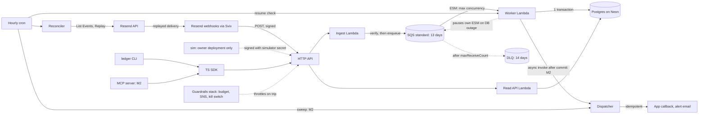

# Architecture

Ledger's architecture decisions and their order of construction. Product context, personas and
non-goals live in [about.md](about.md); verified vendor behavior in [resend.md](resend.md) (`RS-NN`)
and [aws.md](aws.md) (`AWS-NN`); provider choices in [integrations.md](integrations.md); columns in
[data-modeling.md](data-modeling.md); operations in [api-contract.md](api-contract.md). This doc
states how those are built and does not repeat them. [docs/idea.md](../docs/idea.md) is a frozen
RFC (accepted 2026-10-15). Decisions change here.

ADRs carry stable `ADR-NNN` ids that skills and specs cite. Never renumber; a superseded ADR keeps
its number and points forward. An ADR resting on an `[Unverified]` fact names the conditional part
and the slice that settles it ([Open questions owed by slice](#open-questions-owed-by-slice)).

## Accepted direction

- **Verify, then enqueue.** Ingest never touches the database; SQS is the buffer (ADR-001, ADR-002).
- **One immutable ledger, derived state.** `webhook_events` keyed on `svix_id` is the source of
  truth; projections are a pure function of the event set (ADR-003, ADR-004).
- **Postgres only**, with a transactional outbox for every side effect (ADR-005, ADR-006, ADR-017).
- **The queue holds events through a database outage**: the worker pauses its own event source
  (ADR-015).
- **Recovery by id diff + replay** through the normal ingest path (ADR-007).
- **Serverless on AWS CDK**: an app stack plus a guardrails stack, under the cost brake, deployed
  and kept (ADR-010).
- **One contract, many surfaces:** read API → SDK → CLI / MCP, one error shape, from slice 1
  (ADR-011).
- **Logic in packages, apps as thin entry points**, wired by hand on Hono, commander and the MCP
  SDK v2 (ADR-013, ADR-019).

## System shape

Adapted from [idea §5.1](../docs/idea.md#51-architecture-overview). **Source-of-truth rule (MUST).**
`webhook_events` is the only authoritative store. `email_state` and `recipient_state` are caches
that MUST be rebuildable from `webhook_events` alone: dropping and recomputing them yields identical
rows. Any column that cannot be recomputed from the event set MUST NOT live in a projection
([data-modeling.md → Projections are derived](data-modeling.md#projections-are-derived)).

## Reliability core

Every change is judged against these; they outrank evidence, cost, scope and polish
([decision lens](../AGENTS.md#decision-lens--evidence-over-claims-right-sized), tie-break).

| Invariant | Carried by | Evidence | Design test (MUST) |
| --- | --- | --- | --- |
| **No loss**: every event Resend produced for the webhook reaches `webhook_events` | ADR-001, 004, 007, 008, 015 | sim invariant 1 ([invariant-1.ts](../sim/src/invariants/invariant-1.ts)), run live by `pnpm sim --duplicates 0.2 --shuffle` against `apps/local` (slice 1, local; the checker's pass and fail on real Postgres in [invariants.int.test.ts](../sim/src/invariants/invariants.int.test.ts)). On AWS, through a database outage: `pnpm sim --chaos db-outage` (26 of 26 accepted at `200`, DLQ 0, invariant 1 after the resume, slice 3, 2026-10-19). Pending — "down past the retry schedule" fake-API integration test (slice 4) | A change MUST NOT return `200` to Resend before the event is durably enqueued, MUST NOT drop a message without it reaching the DLQ, and MUST NOT let a database outage move messages to the DLQ |
| **No duplicate effects**: at-least-once delivery, exactly-once effects | ADR-004, 006, 017 | pending — sim invariant 3 under `--chaos worker-crash` and `--chaos dispatcher-crash` (slice 6) | Every side effect MUST be an outbox row with a `dedupe_key`, written in the event's transaction; no third-party I/O inside the worker transaction |
| **Order independence**: any arrival order and duplication give the same state | ADR-003 | fast-check properties 1–4 for `projectEmail` in [project-email.projection.prop.test.ts](../packages/core/src/project-email.projection.prop.test.ts) and for `projectRecipient` in [project-recipient.projection.prop.test.ts](../packages/core/src/project-recipient.projection.prop.test.ts) (slice 0); sim invariant 2 ([invariant-2.ts](../sim/src/invariants/invariant-2.ts)) under `--shuffle`, run live against `apps/local` (slice 1, local; pass and fail in [invariants.int.test.ts](../sim/src/invariants/invariants.int.test.ts)) | Projection code MUST NOT read `received_at`, prior projection state or arrival sequence |

### Simulator invariants

`pnpm sim` checks these against its generated ground truth after every run. Every doc cites them
by number. Adapted from [idea §5.9](../docs/idea.md#59-the-chaos-and-simulation-harness).

1. Every generated event is in `webhook_events` exactly once.
2. Every `email_state`, `email_recipients` and `recipient_state` row equals the projection of the
   ground truth (`projectEmail`, `projectRecipient`).
3. No `outbox` `dedupe_key` produced two effects at a receiver: the fake Resend counts sends per
   `Idempotency-Key`, and the simulator's callback receiver counts deliveries per callback id after
   its own dedupe.
4. The DLQ contains only the deliberately poisoned messages.

## Decisions

### ADR-001 — Verify, then enqueue

**Accepted.** Ingest does only local work: decode the body to its exact bytes (`isBase64Encoded`,
AWS-01), verify signature and timestamp on the raw body (RS-01, RS-02), read `type`, enqueue
`{svixId, receivedAt, source, rawBody, headers subset}` (`source` names which secret set verified
the request, `live` or `simulated`, ADR-016; only ingest can set it), return exactly `200` with a
fixed short body.
`401` on a bad signature, `503` when the enqueue fails, so Resend retries (RS-10). Ingest MUST NOT
depend on the database. The response body never echoes payload, PII or secrets, because Resend
stores it (RS-12, [resend.md → Constraint 11](resend.md#constraints-and-sharp-edges)). The `401`
is kept because it is honest and alarmable, **not** because it stops retries: no Resend page says
it does, and repeated failure can auto-disable the endpoint (RS-10, RS-11, RS-U07). This supersedes
the [idea §5.2](../docs/idea.md#52-ingest) rationale ([resend.md → Constraint 4](resend.md#constraints-and-sharp-edges)).
A misconfigured secret is handled like an outage: fix it, re-enable the webhook, reconcile.
Rejected: writing to Postgres in the request path (a database outage becomes failed deliveries, then auto-disable).
**Evidence:** unit tests for the three responses and the fixed bodies: forged, stale, unsigned, one-byte-changed and signed non-JSON requests answer `401` with nothing enqueued, `200` waits for the enqueue to resolve, a rejected enqueue answers `503`, in [create-ingest.test.ts](../packages/ingest/src/create-ingest.test.ts) (slice 1). Both body encodings: a signed request answers `200` plain and base64-encoded with its exact bytes enqueued, a forged one `401` in both with nothing enqueued, and a thrown error leaves as a constant `internal_error`, in [create-ingest-handler.test.ts](../apps/ingest/src/create-ingest-handler.test.ts) (slice 2). An unreadable, unparseable or empty secret set, and an expired set whose refresh fails, answer `503`, never `401`, with nothing enqueued, in [create-ingest.test.ts](../packages/ingest/src/create-ingest.test.ts) (slice 2). With the database unreachable, every delivery still answers `200` on its first attempt: `pnpm sim --chaos db-outage` on the deployed stack printed `sent requests=26 accepted=26 first_attempt_200=26` (slice 3, 2026-10-19).

### ADR-002 — SQS standard, not FIFO

**Accepted.** One standard queue, retention **13 days**, plus a standard DLQ at **14 days**, longer
than the source as SQS requires for standard queues (AWS-07, AWS-09). Resend promises no delivery
order (RS-07) and SQS standard may reorder and duplicate (AWS-06); ADR-003 makes both irrelevant.
Queues use SSE-SQS, no customer-managed key (AWS-25).
Rejected: SQS FIFO (orders arrival at our queue, which means nothing; costs throughput); Kinesis or Kafka (always-on cost).
**Evidence:** `pnpm sim --duplicates 0.2 --shuffle` through the deployed queue: 31 events over 8 emails, 6 duplicated, shuffled, 37 requests all accepted; invariant 1 (31/31 stored once) and invariant 2 (8 emails, 10 recipients) pass, exit 0 (slice 3, 2026-10-19; seed 762806073, namespace 460b0822).

### ADR-003 — Projection is a pure function of the event set

**Accepted; amended 2026-10-16** (owner ruling, [slice 0 pre-proposal](pre-proposals/2026-10-16-slice-0-foundations.md#d1--outcome-precedence-and-ranktype-owner-ruled-2026-10-16) D1).
`projectEmail(events)` sorts by `(event_created_at, rank(type), svix_id)`, as Resend
advises (RS-07), and folds; it is recomputed from the full event set on every new event. Status
follows outcome precedence, not recency: terminal negatives (`bounced`, `failed`, `suppressed`) outrank `delivered`.
The full order, low to high, is `scheduled`, `sent`, `delivery_delayed`, `delivered`, `complained`,
`suppressed`, `failed`, `bounced`: `complained` ranks between `delivered` and the terminal
negatives, because it always follows a delivery (RS-29). `rank(type)` is the same table with
`opened` and `clicked` between `delivered` and `complained` and any other type last
([event-rank.ts](../packages/core/src/event-rank.ts)); status is null until the set holds an
outcome event. Resend documents no precedence of its own (RS-36). Opens and
clicks are counters plus first/last timestamps. `projectRecipient` derives from per-recipient email
states, each folded from the events whose own `data.to` names that recipient (RS-27, RS-43,
[data-modeling.md → `email_recipients`](data-modeling.md#email_recipients--outcome-per-email-and-recipient)); a
hard bounce comes from `bounce.type = Permanent`, never from the event type alone (RS-28, RS-35,
[resend.md → Constraint 7](resend.md#constraints-and-sharp-edges)). Event-specific payload objects
are optional in the Zod schemas (RS-26–RS-29). **Conditional:** `created_at` is used only as a
sort key with `rank` and `svix_id` as tie-breaks, so state stays deterministic whether or not it
tracks the real event time (RS-U10); precedence is property-tested whether or not a bounce can
follow a delivery (RS-U11).
Rejected: incremental `UPDATE status = new` (correctness depends on arrival order); Retrieve Email's `last_event` as status (recency, RS-38).
**Evidence:** fast-check permutation, idempotence, monotonicity and oracle properties for `projectEmail`, one `it` each, with the RS-U10, RS-U11 and two-recipient tests, in [project-email.projection.prop.test.ts](../packages/core/src/project-email.projection.prop.test.ts) (slice 0). The same properties for `projectRecipient`, monotonicity over its sticky states, with the RS-U12 hard-bounce, soft-clears-on-later-delivery, sticky-after-higher-ranked and cross-email tie tests, in [project-recipient.projection.prop.test.ts](../packages/core/src/project-recipient.projection.prop.test.ts) (slice 0). Source: [idea §5.4](../docs/idea.md#54-order-independent-projections), [§9](../docs/idea.md#9-general-questions).

### ADR-004 — Immutable ledger keyed on `svix_id`, one transaction per message

**Accepted; amended 2026-10-15** ([docs review](reviews/2026-10-15-docs-verification/decisions.md): V1-26)**; amended 2026-10-16** ([pp-skills architecture review](reviews/2026-10-16-pp-skills-arch/decisions.md): AO-06).
Per message, one transaction: insert into `webhook_events` `ON CONFLICT (svix_id) DO
NOTHING`; on conflict, commit as a duplicate; otherwise lock the email's `email_state` row,
recompute projections, insert outbox rows, commit. The transaction runs at READ COMMITTED (the
Postgres default) and reads every projection input after it holds the email lock and the recipient
locks; every projection row is created with `INSERT … ON CONFLICT DO NOTHING` before its
`SELECT … FOR UPDATE`. A crash at any point is either nothing or everything.
Unknown and non-email event types, and verified events whose payload fails their type's schema
(typed columns null where unreadable), are stored raw, skipped by projections and counted
(RS-25). The payload is stored as received, minus what Postgres cannot store: before the insert,
the worker replaces each `\u0000` and lone surrogate in the parsed payload with U+FFFD (a pure
`packages/core` function) and counts the event as sanitized (`worker.payload_sanitized`). The sanitized event then takes the
ordinary path: projected when it passes its type's schema, stored raw and counted when it does not.
No retry, no savepoint.
A verified event is never dead-lettered for its content: only unexpected code errors reach
the DLQ (ADR-008), and the simulator's poison message is an injected fault. Dedupe is on `svix_id`,
which Resend's retries keep (RS-06, RS-08), never on the SQS `messageId`, which redrive changes
(AWS-21). **Conditional:** a reconciler replay dedupes only if
it carries the original `svix-id` (RS-U01); slice 4 MUST settle it.
Rejected: dedupe on `(email_id, type)` (collapses distinct events); one transaction per step.
**Evidence:** Testcontainers integration tests, as the runtime role: a sequential duplicate, two concurrent copies of one `svix_id` and a copy under a new `messageId` each leave one row and unchanged projections; a `CHECK (false) NOT VALID` fault after the ledger insert commits nothing, and the redelivery commits one row of everything; a NUL in the subject and a lone surrogate in a tag value are stored with U+FFFD, projected and counted once; the unprojectable kinds (unknown type, `contact.created`, `email.received`, a schema-failing outbound event, a JSON array and a JSON `null` payload) are stored raw and committed on their first receive; out-of-order arrival yields the projection of the stored events; two emails sharing recipients in opposite `data.to` order commit in either interleaving without deadlock, in [record-event.command.int.test.ts](../packages/worker/src/record-event.command.int.test.ts) (slice 1). The sanitizer properties in [sanitize-for-jsonb.prop.test.ts](../packages/core/src/sanitize-for-jsonb.prop.test.ts) (slice 1). Pending — sim invariant 1 (slice 1).

### ADR-005 — Postgres only

**Accepted.** One Postgres database holds ledger, projections, outbox and run records, because
dedupe, row locks and the outbox commit in one transaction. The host is Neon Free in
`aws-us-east-2`, reached over TLS through its pooled URL with `drizzle-orm/node-postgres`, one
connection per Lambda container, pooler-safe SQL only; Aurora Serverless v2 + Data API is the
fallback, switched to only by a superseding ADR on the triggers in
[integrations.md → Decision](integrations.md#decision--neon).
Rejected: multi-database connectors (the Ingester's job); an analytics store; DynamoDB (no multi-row transaction with the outbox); Aurora DSQL (optimistic locking, AWS-49).
**Evidence:** pending — deployed lock test through the pooler, PG-U02 (slice 2). This is otherwise a scope decision.

### ADR-006 — Transactional outbox for reactions

**Accepted; amended 2026-10-15** ([docs review](reviews/2026-10-15-docs-verification/decisions.md): V1-05, V1-08, V1-25).
Reactions are outbox rows with a unique `dedupe_key`, written in the causing event's
transaction and delivered by the dispatcher (ADR-017) with retries and backoff. A rule fires when a
predicate of the recomputed state becomes true, and only on a predicate that, once true, stays true
for every larger event set (for example, a recipient reaching `hard_bounced`), so it becomes true
exactly once in any arrival order; it never fires on an intermediate state, which differs by order.
A projection rebuild writes no outbox rows. Alert emails carry
an `Idempotency-Key` derived from `dedupe_key` (RS-24); keys live 24 h, so an alert's retry horizon
stays under 24 h and past it the entry is marked dead ([resend.md → Constraint 8](resend.md#constraints-and-sharp-edges)).
An alert's subject and body are rendered only from `outbox.payload`, so every retry sends identical
bytes; `409 concurrent_idempotent_requests` is retried, and `409 invalid_idempotent_request` marks
the entry dead with that name in `last_error` (RS-24).
App callbacks are signed, with stable ids, and delivered at least once: a dispatcher crash after
the send re-sends, and the receiver dedupes on the id. The dispatcher sends with a `sending_access`
key only ([integrations.md → Secrets layout](integrations.md#secrets-layout)). Outbox rows caused
by `source = simulated` events are dispatched only to the simulator's receiver sink, never to
Resend or a real callback URL, so a simulator run makes no live Resend write and spends no team
budget.
Rejected: calling third parties from the worker; dedupe in memory.
**Evidence:** pending — `--chaos worker-crash` and `--chaos dispatcher-crash` (kill after send, before commit) produce no second effect, sim invariant 3; retry-horizon unit test; fast-check property: every permutation of an event set emits the same set of `(rule, subject)` reactions (slice 6).

### ADR-007 — Recovery by id diff and replay through ingest

**Accepted; amended 2026-10-15** ([docs review](reviews/2026-10-15-docs-verification/decisions.md): V1-02, V1-03, V2-03)**; amended 2026-10-16** ([pp-skills architecture review](reviews/2026-10-16-pp-skills-arch/decisions.md): AO-03, AO-12).
On the hourly cron and on demand, the reconciler reads the configured webhook's `status` first
(its id is a deploy input, [integrations.md → Secrets layout](integrations.md#secrets-layout)) and
stops with `webhook_disabled` if it is disabled (RS-11, RS-13). It then pages List Events newest
first (RS-14), skips events younger than its grace window (10 minutes, or the source queue's
`ApproximateAgeOfOldestMessage`, AWS-22, when that is longer; locally the oldest visible
`local_queue_messages` row), so an event ingest acknowledged that is still queued is neither
counted missing nor replayed. A dead-lettered event is replayed once per run until it is redriven
or purged; the DLQ alarm already shows it (ADR-008). It stops at a lookback horizon (default 3
days, above the ≈ 27.6 h retry schedule, RS-09; extended back to the `horizon_end` of the last run
that finished without an `error_code` when that is older, capped at 30 days, RS-31, and at List
Events reach, RS-U03, so a span when runs could not run, such as a tripped kill switch, a database
outage or a quota suspension, is covered with no `--lookback`), diffs ids against
`webhook_events`, and replays the missing ones (RS-16). A replay re-enters through ingest, so
verification and dedupe apply unchanged. One failed replay never aborts a run; runs never overlap
and stay inside a time budget below the Lambda timeout (AWS-03), one constant shared by the start
check and the abandoned derivation below:
- **Start:** one transaction takes `pg_advisory_xact_lock` on a fixed reconcile key, refuses with
  `reconcile_in_progress` if an unfinished run is inside its time budget, and inserts its row.
- **Claim:** async invoke is at-least-once and can deliver one event twice without an error
  (AWS-53), so before any Resend call the reconciler runs `UPDATE reconcile_runs SET claimed_at =
  now() WHERE id = $1 AND claimed_at IS NULL`; zero rows means a duplicate invoke, which exits
  without work. The invoke sets `MaximumRetryAttempts: 0`.
- **Abandoned:** a run with no `finished_at` past its time budget (it crashed, or its invoke was
  lost) will not finish. `packages/api` derives `run_abandoned` on read and never writes it to the
  row ([api-contract.md → Error codes](api-contract.md#error-codes)); the next hourly run covers the
  horizon.

Each run writes a `reconcile_runs` row. Same approach as Ingester [PR #13](https://github.com/resend/resend-webhooks-ingester/pull/13),
cited, not claimed. **Conditional:** the id diff holds only if List Events ids are `svix-id`s
(RS-U02) and a replay keeps the `svix-id` (RS-U01) and passes the timestamp window (RS-U20), all
three MUST be settled in slice 4; recoverable range is bounded by List Events reach (RS-U03); the
grace window assumes visibility within minutes (RS-U13).
Rejected: a write path that inserts fetched payloads directly (bypasses verification); diffing by delivery status (misses "acknowledged but never stored").
**Evidence:** pending — fake-API integration tests: outage past the retry schedule → 100 % recovered, 0 duplicates; a 5-day gap since the last good run recovered with no `--lookback`; disabled webhook; `429` with `retry-after`; a queued backlog older than 10 minutes is not replayed; a second invoke of a claimed run makes no Resend call; a run past its budget with no `finished_at` reads `run_abandoned` through `reconcile.getRun` and `gaps.list` (slice 4). Source: [idea §5.5](../docs/idea.md#55-reconciler-recovering-missed-events).

### ADR-008 — Backpressure: bounded concurrency, partial batch failure, DLQ

**Accepted.** The worker's ESM sets `MaximumConcurrency` (≥ 2, AWS-04) as the backpressure valve
on Postgres connections, batch size 10 with no batching window (AWS-17), and
`ReportBatchItemFailures`, building the failure list from per-message results because an empty
response deletes the whole batch (AWS-05). Visibility timeout is derived as 6 × worker timeout +
batching window (AWS-08). `maxReceiveCount` is configurable, default 5 (AWS-09). The worker
reserves no concurrency (AWS-16). DLQ messages are inspected by a `read` operation and redriven
by an `operate` action (`StartMessageMoveTask`, AWS-21; scopes in
[api-contract.md](api-contract.md#dlqlistmessages)).
Rejected: unbounded concurrency; whole-batch retry; reserved concurrency as the valve (blocked by unpublished new-account quotas, AWS-U05).
**Evidence:** a batch of three with one invalid envelope lists exactly that message and commits the other two, on real Postgres, in [create-worker.int.test.ts](../packages/worker/src/create-worker.int.test.ts) (slice 1). The Lambda handler returns `batchItemFailures` exactly as the worker built them (three SQS records, one failure → that `messageId` alone), and rethrows a thrown error as a constant so the whole batch is redelivered, never an empty response, in [create-worker-handler.test.ts](../apps/worker/src/create-worker-handler.test.ts) (slice 2). A poison message is dead-listed after its fifth receive while the other four commit once, and after the fault is removed the redrive commits it once, in [poison-isolation.int.test.ts](../packages/worker/src/poison-isolation.int.test.ts) (slice 3). On the deployed stack, `pnpm sim --poison 1` stored the 28 other events exactly once and passed invariant 4 (the DLQ holds exactly the one poisoned event), and `LedgerApp-dlq-depth` went to `ALARM`; `ledger dlq inspect` showed ids and counts only, `ledger dlq redrive` returned the depth to 0, and the poisoned `svix_id` then appeared once in `ledger email` (slice 3, 2026-10-19; seed 2062249550, namespace fc5e65ba). `pnpm sim --burst 10000/10s` on the deployed stack: 10,000 of 10,000 requests accepted in 16.8 s, every event stored after 101 s, invariants 1, 2 and 4 pass, exit 0 (slice 3, 2026-10-19; seed 1896464210, namespace 154010c8).

### ADR-009 — Multi-secret verification and timestamp tolerance

**Accepted.** Ingest verifies against the configured set of signing secrets, one `verify` call per
secret, first match wins (RS-02), and rejects `svix-timestamp` more than 5 minutes off (RS-02,
RS-03). Resend signs with both the old and new secret for 24 h after a rotation (RS-04), so the set
is required, not defensive: the adopter adds the new secret, rotates, retires the old one inside
24 h. Ingest re-reads the set at most every 5 minutes (a per-container cache TTL), so an added or
retired secret takes effect within 5 minutes, with no redeploy. The loop ships with ingest in slice
1; slice 4 adds the rotation runbook and the retired-secret test. **Conditional:** how both
signatures appear in the header (RS-U09) does not matter to a per-secret loop.
Rejected: one secret with a redeploy on rotation (drops deliveries for the redeploy window).
**Evidence:** unit tests with old, new and both signatures in one header, forged and stale (6 min) requests, in [create-ingest.test.ts](../packages/ingest/src/create-ingest.test.ts), signed by the test signer that `resend`'s `webhooks.verify` accepts in [sign-webhook.test.ts](../packages/ingest/src/sign-webhook.test.ts) (slice 1). Pending — retired secret → `401` once the cache TTL passes, with a fake clock (slice 4).

### ADR-010 — Serverless on AWS CDK: an app stack and a guardrails stack

**Accepted.** API Gateway HTTP API, Lambda (arm64, AWS-20), SQS, EventBridge Scheduler, Secrets
Manager, CloudWatch and SNS in us-east-2. No VPC: a VPC-attached Lambda needs a NAT gateway (AWS-13).
The read API is a Lambda behind the same HTTP API. Every function logs to an explicit log group with
30-day retention and `DESTROY` (AWS-29, AWS-40); every secret sets `DESTROY` (AWS-38). The budget,
its notifications and the kill switch live in a separate **guardrails stack**, deployed with the
first app deploy, so no redeploy or failed deploy opens a budget-alarm gap; design in
[aws.md → Budget alarms](aws.md#budget-alarms) (cap USD 50, kill switch off by default, on in the
owner's deployment). The teardown command removes both, the guardrails stack only after the app
stack's destroy succeeds ([aws.md → Teardown](aws.md#teardown)).
**Conditional:** the cap holds only if the budget deploys from us-east-2 (AWS-U01) and a route
throttle of `0` stops billing (AWS-U02); both MUST be settled in slice 2.
Rejected: containers on any path; NAT gateways; provisioned RDS; RDS Proxy (AWS-48); Budget Actions as the stop (they cannot stop Lambda, AWS-36).
**Evidence:** CDK assertion tests, one per cost-brake property plus the budget and kill-switch wiring, both kill-switch settings synthesized: [app.stack.test.ts](../infra/src/app.stack.test.ts), [guardrails.stack.test.ts](../infra/src/guardrails.stack.test.ts) (slice 2); bundles load with no AWS access and no Docker fallback: [bundle-smoke.test.ts](../infra/src/bundle-smoke.test.ts), [esbuild-installation.test.ts](../infra/src/esbuild-installation.test.ts). Pending: recorded trip drill; post-destroy listing finds nothing billable (slice 2); idle cost after 30 days in [aws.md → Cost shape](aws.md#cost-shape).

### ADR-011 — One contract, many surfaces

**Accepted; amended 2026-10-16** ([pp-skills run](reviews/2026-10-16-pp-skills/decisions.md): P-01, P-03).
The read API is described by OpenAPI and validated with Zod; the SDK is generated types plus a
thin client (stack in ADR-019); the CLI and MCP server are built only on the SDK. One error shape
everywhere ([error shape](../AGENTS.md#error-shape)). Bearer tokens carry `read` or `operate`
scope; MCP operate tools are not registered without `operate`. **The contract starts in slice 1**
(owner, 2026-10-15): a minimal read API, SDK and `ledger email` / `ledger recipient` run locally,
and each later slice adds the operations its stage needs: health (slice 2), DLQ inspect and redrive
(slice 3), gaps and reconcile (slice 4). The same API code runs in the local dev server and behind
the HTTP API. `packages/sdk` never depends on server code: a root script, `pnpm openapi:export`,
writes the committed, generated `packages/sdk/openapi.json` from `packages/api` (ADR-013);
`openapi-typescript` generates the SDK's type file from it, also committed; a `pnpm verify` stage
fails when either file drifts from its source. This resolves the conflict between
[idea §7](../docs/idea.md#7-implementation-plan) phase 1 (CLI reads the database) and [module boundaries](../AGENTS.md#module-boundaries) in favor of
the boundary: every slice is hand-walkable without SQL (lens clause 3), and no throwaway read path
is built.
Rejected: CLI or MCP reading the database directly; a dev-only inspection script (throwaway); per-surface error formats.
**Evidence:** the drift stage fails on a stale `openapi.json` or SDK type file: the `drift` stage of [`scripts/verify.mjs`](../scripts/verify.mjs), [`openapi-drift.mjs`](../scripts/openapi-drift.mjs), whose one-byte canary runs first on every run (slice 1); one error shape with registry codes, masks only, on the read API: [get-email.route.int.test.ts](../packages/api/src/get-email.route.int.test.ts), [get-recipient.route.int.test.ts](../packages/api/src/get-recipient.route.int.test.ts) and [create-api.test.ts](../packages/api/src/create-api.test.ts) (slice 1). Pending — SDK ↔ API contract tests and CLI `--json` output tests (slice 1, grown per slice); error-registry mirror test and MCP tool-registration test per scope (slice 5).

### ADR-012 — `resend-client` is the sole Resend API caller

**Accepted; amended 2026-10-15** ([docs review](reviews/2026-10-15-docs-verification/decisions.md): V1-04).
Every Resend API call goes through `packages/resend-client`. Each calling function holds one
limiter instance, 2 req/s by default, that yields when `ratelimit-remaining` falls below half of
`ratelimit-limit` and waits `retry-after` on `429`, because the 10 req/s budget is per team, shared
by every key and endpoint (RS-19, RS-20). The SDK never throws or retries (RS-23), so every response is checked and
errors are mapped by status, then name, with a default branch (RS-22). Every request carries a
`User-Agent` (RS-21). Rules in [integrations.md → Locked rules](integrations.md#locked-rules-must).
Every calling function is single-flight (the reconciler by non-overlapping runs, ADR-007; the
dispatcher by its transaction lock, ADR-017), so Ledger's total stays ≤ 2 × 2 req/s.
Rejected: calling the `resend` SDK from apps directly; a limiter shared across functions through a table or service (single-flight callers make it unnecessary).
**Evidence:** pending — limiter unit tests (rate, yield on low `remaining`, `retry-after`); fake-API `429` storm completes the run (slice 4).

### ADR-013 — Pure core and local mode

**Accepted; amended 2026-10-16** ([pp-skills run](reviews/2026-10-16-pp-skills/decisions.md): P-03).
`packages/core` imports nothing from AWS, Postgres or Resend. Ingest and worker meet at a queue
port: slice 1 runs both in one local process (`apps/local`) with an in-process implementation, SQS
implements it on AWS (slice 2), and a Postgres-backed queue (`FOR UPDATE SKIP LOCKED`, row locks in
its own short claim transaction, so receive counts survive a failed attempt, pooler-safe) implements
it for `docker compose up` with no AWS account (slice 2B).
- **Logic lives in packages.** `packages/ingest`, `packages/worker`, `packages/dispatcher`,
  `packages/reconciler` and `packages/api` (the Hono app factory, ADR-019) export factories over
  ports and import no Lambda event types.
- **Apps are entry points.** Each `apps/<fn>` is Lambda event adaptation plus its composition root
  (ADR-019). `apps/local` composes the same factories with local adapters (`@hono/node-server`, the
  in-process queue, from slice 2B the Postgres queue) for local mode and `docker compose`, so no app
  imports another.
- **`packages/shared` is the kernel:** the port interfaces (the queue port and the others), logger
  and metrics helpers, config and env loading with a boot-time Zod assertion, the error base class
  carrying a registry `code` ([api-contract.md → Error codes](api-contract.md#error-codes)), the
  clock, and the token mint and tag check. It imports nothing from AWS, Postgres or Resend.
- **`packages/aws` is the only importer of `@aws-sdk/*`:** the SQS queue adapter, Secrets Manager,
  ESM control, SQS attributes, DLQ receive and redrive, Lambda invoke. It lands in slice 2, when
  each adapter has a second consumer.
- Each package lands in the slice that first needs it ([Projects](../AGENTS.md#projects)).

Rejected: AWS-only development (LocalStack as the only local path); an `apps/local` exception to "apps never import apps"; one `packages/app` with subfolders (its boundaries would need lint rules, where pnpm's declared dependencies enforce them for free).
**Evidence:** the lint rule on `packages/core` and `packages/shared` imports rejects the AWS, Postgres and Resend package families (`@aws-*/**`, `aws-*`, `@smithy/**`, `pg`, `pg-*`, `postgres`, `drizzle-*`, `@neondatabase/**`, `resend`, `@react-email/**` and the rest of the list in [pp-general → Lint enforcement](../.agents/skills/pp-general/references/imports-and-tsconfig.md#lint-enforcement-biome)), subpaths included, run with the committed `biome.json` in [import-boundaries.test.ts](../packages/core/src/import-boundaries.test.ts), one fixture per pattern (slice 0). Pending — sim invariants pass in local mode (slice 2B).

### ADR-014 — Raw-payload retention and redaction

**Accepted.** A configurable job redacts personal data in raw payloads after N days. Redaction MUST
keep every field projections read, so the source-of-truth rule survives: it replaces `to`, `from`
and `subject` with their idempotent masks and nulls the fields no projection reads, in every event
type, non-email and unknown types included. Projections hold only keyed address hashes and masks,
never raw PII (owner, 2026-10-15;
[data-modeling.md → PII & retention](data-modeling.md#pii--retention)). Resend itself keeps email
data 30 days (RS-31).
Rejected: deleting ledger rows (breaks recovery diffing and rebuilds).
**Evidence:** pending — integration test: rebuild after redaction yields identical projections (slice 7). Source: [idea §6.3](../docs/idea.md#63-data-model-initial).

### ADR-015 — The worker pauses its own event source on a database outage

**Accepted** (owner, 2026-10-15); **amended 2026-10-16** ([pp-skills architecture review](reviews/2026-10-16-pp-skills-arch/decisions.md): AO-05).
Every failed receive counts toward `maxReceiveCount` (AWS-09), so
without this a database outage longer than ~15–30 min would drain the queue into the DLQ
([aws.md → Constraint 4](aws.md#constraints-and-sharp-edges)), contradicting
[idea §6.4](../docs/idea.md#64-failure-modes-and-expected-behavior) ("Queue holds events"). So:
- On a connection-class error, the worker retries once on a fresh connection (a connection dropped
  by a Neon suspend is not an outage, PG-U04). If that fails too, it reports every message in the
  batch as failed and disables its own ESM (`Enabled: false`, AWS-18). Messages wait in the queue,
  up to its 13-day retention (AWS-07). Other errors follow ADR-008 to the DLQ, so poison isolation
  is unchanged.
- **Out of storage** counts as connection-class: Neon Free caps storage at 1 GB and the ledger
  never deletes, so at the cap every insert fails. Neon's storage-limit error (PG-U07) raises
  `database_unavailable` and pauses the worker, so the queue holds instead of draining to the DLQ.
  The storage budget is in [integrations.md → Cadence](integrations.md#cadence-and-the-database),
  and the health read reports storage used.
- **Resume:** the hourly cron invokes the worker function with a resume event. If the ESM is
  paused, it probes Postgres and re-enables the ESM when the probe succeeds. The probe also reads
  storage used and fails while it is at the storage budget's limit: a read succeeds on a full
  database, so a read-only probe would re-enable, fail and re-pause every hour, spending a receive
  per message until the queue drained after all. A healthy stack never
  probes, so this adds no database wake ([integrations.md → Cadence](integrations.md#cadence-and-the-database)).
  An `operate` action triggers the same resume on demand.
- **Kill-switch safe by construction:** a tripped kill switch sets the worker's reserved
  concurrency to `0` (AWS-16), so the resume invocation cannot run, and only the scripted re-arm
  restores the ESM ([aws.md → Budget alarms](aws.md#budget-alarms)).
- A paused worker shows in the health read and fires the queue-age alarm (AWS-22).

Rejected: automatic DLQ redrive after recovery (needs a failure classification to keep poison messages from looping); a larger `maxReceiveCount` (covers only a bounded outage and delays poison isolation); accepting the drain plus a manual redrive (a manual step after every outage on the adopter's path fails the self-service test, lens clause 4).
**Evidence:** the classifier's unit test, `53100` and `Query read timeout` included, in [classify-database-error.test.ts](../packages/db/src/classify-database-error.test.ts), and what a stopped Postgres actually raises, in [classify-database-error.int.test.ts](../packages/db/src/classify-database-error.int.test.ts) (slice 2). Testcontainers, database stopped: a batch of three lists all three, the event source reads `paused` after that one batch, and after the resume the redelivered batch commits with every receive count below `maxReceiveCount`, so none reaches the DLQ; a connection the server ends mid-transaction is retried on a fresh one and commits; any other error lists its message alone; a failing pause logs `worker.pause_failed` with the response unchanged, in [database-outage.int.test.ts](../packages/worker/src/database-outage.int.test.ts) (slice 2). The resume: an enabled source answers `already_enabled` with no connection opened, a paused one is re-enabled when the probe connects below the threshold and stays paused at the storage limit or with the database unreachable, in [resume.int.test.ts](../packages/worker/src/resume.int.test.ts) (slice 2). Neon's storage-limit error is `53100`, from Neon's source (PG-U07, settled 2026-10-19, [integrations.md](integrations.md#unverified)). On the deployed stack, `pnpm sim --chaos db-outage` repointed the database secret: 26 of 26 deliveries answered `200`, the worker paused (`worker paused after 0s`), `LedgerApp-queue-age` read `ALARM` after 18 min with the DLQ at 0 (its email reached the owner at 14:54 UTC, the transition's own minute), and after the restore and the operator's `ledger worker resume` (`worker enabled after 1m`) the queue drained, 26 of 26 stored, and invariants 1, 2 and 4 pass, exit 0 (slice 3, 2026-10-19; seed 2220398234, namespace 6eee59f5).

### ADR-016 — The simulator reaches AWS only through an opt-in simulator secret

**Accepted** (owner, 2026-10-15); **amended 2026-10-15** ([docs review](reviews/2026-10-15-docs-verification/decisions.md): V1-58).
An off-by-default deploy flag, the public variable `LEDGER_SIMULATOR` (`on` | `off`, read by
`pnpm aws:deploy`), creates one extra secret, `ledger/simulator-signing-secret`, read by
ingest only. Ingest verifies against it after the Resend
set and stamps matching events `source = simulated`. The simulator generates fresh `svix_id`s and
never reuses one captured from a real delivery, so a simulated event cannot displace a live one.
Only the owner's deployment sets the flag, and
that stack holds test-address data only ([about.md → Risk appetite](about.md#risk-appetite)). An
adopter's stack therefore never accepts a second, test signing secret, and the simulator never
targets a stack holding adopter data ([features.md → verify](features.md#adopter-lifecycle)). The
simulator is `sim/`, run as `pnpm sim`, not a `ledger` subcommand: it holds a signing secret and
checks invariants through `packages/db`, both of which the CLI must never do (ADR-011). The simulator's control-plane steps, the burst's throttle and the chaos faults, run under the owner's credentials through `@ledger/aws`; every event still enters through ingest. Cost:
USD 0.40/month, in the owner's deployment only (AWS-11). Locally (slices 1 and 2B), ingest reads an
optional `LEDGER_SIMULATOR_SECRET` from `.env.local`, verified after the Resend set and stamping
`simulated` exactly as on AWS.
Rejected: a separate demo stack (doubles the idle secret and alarm lines); injecting straight into SQS (bypasses ingest, so no ingest latency numbers for slice 9).
**Evidence:** CDK assertion tests, synthesized both ways: without the flag the template has no simulator secret and ingest's environment and policies reference none; with it, the third secret is read by ingest's role alone, in [app.stack.test.ts](../infra/src/app.stack.test.ts) (slice 3). A simulator-signed delivery answers `401` with nothing enqueued when no simulator secret id is configured, in [create-ingest.test.ts](../packages/ingest/src/create-ingest.test.ts), and ingest's config reads `SIMULATOR_SECRET_ARN` only when set, in [create-ingest-handler.test.ts](../apps/ingest/src/create-ingest-handler.test.ts) (slice 3). `LEDGER_SIMULATOR=on` without a valid `LEDGER_SIMULATOR_SECRET` refuses before any AWS call; `on` synthesizes with the flag and writes the value after `cdk deploy`; `off` and unset write none; no output line holds the value, in [run-deploy.test.ts](../infra/scripts/run-deploy.test.ts) (slice 3).

### ADR-017 — The dispatcher is triggered after commit, plus an hourly sweep

**Accepted; amended 2026-10-15** ([docs review](reviews/2026-10-15-docs-verification/decisions.md): V1-04).
When a worker transaction commits outbox rows, the worker invokes the dispatcher asynchronously.
The dispatcher is single-flight: its transaction first takes `pg_try_advisory_xact_lock` on a fixed
dispatcher key (transaction-scoped, so pooler-safe), and an invocation that does not get the lock
exits, because the holder or the next sweep delivers. The holder claims up to 10 due rows
`FOR UPDATE SKIP LOCKED`, repeating until none is due; per batch it delivers them, and records the
outcome. A sweep on the shared hourly cron retries what failed or was never triggered. No
sub-hourly schedule touches Postgres, which keeps the idle wake budget
([integrations.md → Cadence](integrations.md#cadence-and-the-database)); hourly retries fit inside
the 24 h idempotency-key horizon (ADR-006). Each delivery has an HTTP timeout well below the
Lambda timeout, and outcomes commit with their batch, so a crash re-sends at most one batch, which
the receivers absorb (ADR-006, sim invariant 3). A lost async invoke only delays delivery to the
next sweep.
Rejected: an outbox-notify SQS queue with its own ESM (idle polling cost, AWS-24, AWS-U03); dispatching inline in the worker after commit (couples worker latency and failures to third parties); a sub-hourly poller (breaks the wake budget).
**Evidence:** pending — integration test: an invoke dropped after commit is delivered by the sweep, once; two concurrent invokes deliver from one container only; sim invariant 3 (slice 6).

### ADR-018 — Migrations run from the deploy command, before the code that needs them

**Accepted; amended 2026-10-15** ([docs review](reviews/2026-10-15-docs-verification/decisions.md): V1-24, V1-37)**; amended 2026-10-16** ([pp-skills run](reviews/2026-10-16-pp-skills/decisions.md): S-05; [pp-skills architecture review](reviews/2026-10-16-pp-skills-arch/decisions.md): AO-07).
The deploy command first ensures the DML-only runtime role exists, then runs the
drizzle-kit-generated migrations through drizzle-orm's programmatic `migrate()` (drizzle-kit stays a
dev-only generator; the entry point is `prepareDatabase` in `packages/db`, slice 1) with the
**direct** Postgres URL supplied by the deployer (each change that creates a
table grants its DML to that role, in a custom migration right after the generated one), then `cdk deploy` ships code; runtime Lambdas use only the pooled URL and
never migrate ([integrations.md → How it is used](integrations.md#decision--neon)). The deploy
command refuses to run while the kill switch is tripped (the worker's reserved concurrency reads
`0`) unless it runs as the re-arm, and restores an ADR-015 pause after `cdk deploy` if the worker's
ESM was paused before it, because whether a CloudFormation update re-applies the template's
`Enabled: true` is AWS-U09. Migrations are expand/contract only, so code from the previous deploy
runs against the new schema and no deploy needs downtime. A contract step carries
`-- contract-step: <commit SHA>`, the commit that stopped using the object; the app stack exports
the deployed commit as stack output `DeployedCommit`, and before migrating the deploy command
refuses any pending contract step whose SHA is not an ancestor of it
(`git merge-base --is-ancestor`), so a `DROP` never runs under Lambdas that still use the object.
Rejected: migrating from a runtime Lambda (needs the direct URL at runtime; concurrent cold starts race); a CDK custom resource (adds a Lambda whose failure blocks the deploy).
**Evidence:** CI applies every migration to a fresh Postgres before the integration tests, and the Testcontainers harness ensures the runtime role before migrating: the `int` stage of [`scripts/verify.mjs`](../scripts/verify.mjs), whose global setup [`postgres-global-setup.ts`](../packages/db/src/testing/postgres-global-setup.ts) runs [`prepareDatabase`](../packages/db/src/prepare-database.ts) before any test, which then connects as the runtime role (slice 1); the `migrations` stage of [`scripts/verify.mjs`](../scripts/verify.mjs), [`scripts/migration-lint.mjs`](../scripts/migration-lint.mjs), fails a migration with `DROP`, `RENAME`, `ALTER … TYPE` or `SET NOT NULL` unless its first line carries the contract-step marker, after an in-memory canary proves an unmarked `DROP COLUMN` fails and a marked one passes (slice 2); [`run-deploy.test.ts`](../infra/scripts/run-deploy.test.ts) (unit, fake steps) proves the deploy command refuses a contract step whose SHA is an ancestor of `HEAD` but not of the deployed `DeployedCommit` (the real `git merge-base` over a throwaway repository), skips that check with no app stack, refuses a tripped stack and every other unsafe state before any migration or stack change, migrates before it deploys `LedgerGuardrails` then `LedgerApp`, and restores a recorded ADR-015 pause also when the app deploy fails (slice 2).

### ADR-019 — Application and surface stack

**Accepted** (owner, 2026-10-16; [pp-skills run](reviews/2026-10-16-pp-skills/decisions.md): P-01).
- **Read API:** Hono with `@hono/zod-openapi`, which generates OpenAPI 3.1 (`app.doc31()`) from the
  Zod route schemas and shapes validation failures in one `defaultHook` into the
  [error shape](../AGENTS.md#error-shape) ([README](https://raw.githubusercontent.com/honojs/middleware/main/packages/zod-openapi/README.md)).
  One app object, built by `packages/api` (ADR-013), runs on Lambda through `@hono/aws-lambda` and
  locally through `@hono/node-server`, which is how "the same API code runs locally" (ADR-011)
  holds. `hono/aws-lambda` is deprecated and goes in Hono v5 ([npm](https://registry.npmjs.org/@hono/aws-lambda),
  [docs](https://hono.dev/docs/getting-started/aws-lambda)).
- **Other functions:** plain typed handlers. Each `apps/*` has one composition root that wires
  concrete classes by hand: no DI container, no decorators. Command and reader classes keep one
  public `execute(input)`.
- **CLI:** `commander` 15 with `@commander-js/extra-typings` 15 (owner, O-13, 2026-10-16):
  commander 15.0.0 is npm `latest` (2026-05-29, ES modules only) and 14 gets security fixes only,
  until May 2027 ([npm](https://registry.npmjs.org/commander)).
- **MCP:** `@modelcontextprotocol/server` v2 over stdio, stable since 2.0.0 (2026-07-27,
  [npm](https://registry.npmjs.org/@modelcontextprotocol/server)).
- **SDK:** types generated by `openapi-typescript` plus `openapi-fetch`, behind a thin hand-written
  client (ADR-011).
- **Zod 4**, which `@hono/zod-openapi` (peer `zod ^4.0.0`, [npm](https://registry.npmjs.org/@hono/zod-openapi/latest))
  and the MCP SDK (`zod ^4.2.0`) both require.

Close to Resend's public stack: the [handbook](https://resend.com/handbook/engineering/what-is-our-tech-stack)
names no backend framework; Resend's CLI uses `commander` 14 with extra-typings
([package.json](https://raw.githubusercontent.com/resend/resend-cli/main/package.json)) and its MCP
server uses SDK v2 ([package.json](https://raw.githubusercontent.com/resend/resend-mcp/main/package.json)).
Choosing a package here is not installing it: each dependency stays Ask-first, added in the slice
that first needs it ([Permissions](../AGENTS.md#permissions)), with its version pinned then.
Exception: the scaffold's framework packages (TypeScript, Biome, Vitest, `@types/node`, Hono and its
adapters, Zod, `commander` 15 with extra-typings, `@modelcontextprotocol/server` 2, AWS CDK) were
installed when every project was scaffolded, and the owner ratified them at their pinned versions
(owner, 2026-10-16). Every other dependency still waits for its slice.
Rejected: NestJS (CDK `NodejsFunction` and Vitest compile with esbuild, which emits no decorator metadata, [esbuild #915](https://github.com/evanw/esbuild/issues/915), so DI needs build workarounds; about 1 s of init on a mono-Lambda, [report](https://dev.to/aws-builders/aws-lambda-cold-starts-the-case-of-a-nestjs-mono-lambda-api-4j42), paid on ingest's cold path, CBL-21; `nestjs-zod` peers only Nest ≤ 11, now the `legacy` line, [npm](https://registry.npmjs.org/nestjs-zod/latest)); Fastify with `@fastify/aws-lambda` (heavier, and Zod needs a type provider); a hand-rolled router (OpenAPI and the local server built by hand); oclif (overkill for a small CLI) and clipanion (long at release candidate); `@hey-api/openapi-ts` (pre-1.0, generates more than a thin client needs) and `orval` (frontend-oriented: query hooks and mocks); MCP SDK v1, `@modelcontextprotocol/sdk` (maintenance line only, [repo](https://github.com/modelcontextprotocol/typescript-sdk)).
**Evidence:** `@hono/zod-openapi` routes generate the committed OpenAPI 3.1 document, held to it by the `drift` stage ([`openapi-drift.mjs`](../scripts/openapi-drift.mjs)); one `defaultHook` and one `onError` shape every failure, the library's `415` included: [get-recipient.route.int.test.ts](../packages/api/src/get-recipient.route.int.test.ts), [get-email.route.int.test.ts](../packages/api/src/get-email.route.int.test.ts) and [create-api.test.ts](../packages/api/src/create-api.test.ts) (slice 1). The same app object passes the same SDK ↔ API contract suite, [`readApiContract`](../packages/api/src/testing/read-api-contract.ts), under `@hono/node-server` in [sdk-contract.int.test.ts](../apps/local/src/sdk-contract.int.test.ts) and through the `@hono/aws-lambda` handler with synthetic payload-2.0 events in [api-lambda-contract.int.test.ts](../apps/api/src/api-lambda-contract.int.test.ts) (slice 2). Ingest `Init Duration` on the deployed stack: 204 cold starts in a 10,000-event burst, median 387 ms, max 565 ms (slice 3, 2026-10-19; [CBL-21](check-before-launch.md)). Pending — CLI `--json` output tests (slice 1); MCP tool-registration test (slice 5).

## Technology

| Concern | Choice | Note |
| --- | --- | --- |
| Language / runtime | TypeScript (strict), Node.js 24 (`engines` in `package.json`) on arm64 Lambda (`nodejs24.x`, AWS-54, [aws.md](aws.md)), ES modules (`"type": "module"`), pnpm workspaces | Resend's public stack; arm64 is 20 % cheaper per GB-s (AWS-20) |
| DB / migrations | Postgres on Neon, Drizzle ORM (`node-postgres`) + drizzle-kit | ADR-005, ADR-018 |
| Validation | Zod 4 | Requests, responses, webhook payloads, env config; required by `@hono/zod-openapi` and the MCP SDK (ADR-019) |
| HTTP framework | Hono + `@hono/zod-openapi` (OpenAPI 3.1 from Zod); `@hono/aws-lambda` on Lambda, `@hono/node-server` locally, one app object | ADR-019, ADR-011 |
| Handlers and wiring | Plain typed handlers; one hand-wired composition root per `apps/*`; command and reader classes with one `execute(input)` | ADR-019, ADR-013. No DI container, no decorators |
| SDK generation | `openapi-typescript` + `openapi-fetch`, behind a thin hand-written client | ADR-019, ADR-011 |
| CLI | `commander` 15 + `@commander-js/extra-typings` 15 | ADR-019 (O-13); Resend's CLI uses the same pair at 14 |
| Tests | Vitest, fast-check, Testcontainers | Property tests are first-class |
| Lint / format | Biome | |
| Workspace orchestration | pnpm workspaces and root `package.json` scripts; no Turborepo (owner, 2026-10-16) | No package emits a build output to cache (packages ship TypeScript source); Biome and Vitest each run as one root process; typecheck is one `tsc` pass. Revisit when a measured `pnpm check` exceeds 60 s or a package emits a build output |
| Local development database | `compose.yaml`: `postgres:18.6-alpine` on `127.0.0.1:55432`, started by `pnpm dev:full` (owner, 2026-10-16) | Loopback only, no cost. Integration tests never use it (Testcontainers). Slice 2B adds `apps/local` to the same file |
| Secret scan | gitleaks, version-pinned Docker image, a `pnpm verify` stage (owner, 2026-10-15) | Not in Resend's public stack: the repo is public and nothing in that stack scans history. Docker is already needed for Testcontainers, so it adds no install. Upstream says gitleaks is feature complete and now gets security patches only |
| Logging / metrics | Winston JSON; CloudWatch EMF custom set: `ingest.accepted`, `ingest.rejected{reason}` (`reason` ∈ `signature`, `timestamp`), `worker.duplicates`, `worker.processing_lag`, `reconcile.missing`, `reconcile.replayed`, `reconcile.failed`, `projection.unknown_event_type`, `worker.payload_sanitized` (ADR-004); vended SQS (queue age, DLQ depth), Lambda and API Gateway metrics for alarms | Ids on every line, never as metric dimensions (AWS-12, AWS-30). The set is idea §5.8's minus the queue metrics SQS vends free (AWS-22) |
| Resend | `resend` Node SDK: API calls only inside `packages/resend-client`; `webhooks.verify` (local crypto, RS-02) in `packages/ingest` | ADR-012, ADR-009, ADR-013 |
| Infra / CI | AWS CDK (app + guardrails stacks), GitHub Actions | ADR-010 |
| MCP | `@modelcontextprotocol/server` v2, stdio | ADR-019, ADR-011 |

## Cost envelope

Cost shape, per-service numbers and the budget-alarm design are canonical in [aws.md](aws.md).
Posture: **deploy, record, keep**. The stack stays up until the owner tears it down, so idle cost
MUST stay near zero (≤ USD 5/month, [about.md → Success metrics](about.md#success-metrics)) and the
hard monthly cap MUST alarm and trip before unbounded spend. A resource with idle cost needs a
measured reason in an ADR. Neon Free bills nothing and sits outside the AWS budget
([integrations.md → Decision](integrations.md#decision--neon)).

## Deferred (YAGNI)

| Defer | Kind | Because | Tripwire |
| --- | --- | --- | --- |
| SQS FIFO | categorical | Arrival order at our queue is meaningless (ADR-002, ADR-003) | Superseding ADR only |
| Multi-database connectors, warehouse loading | categorical | The Ingester ships them; Ledger's workload is transactional ([about.md → Non-goals](about.md#non-goals--out-of-scope), ADR-005) | Superseding ADR only |
| Multi-tenant hosting | categorical | One installation, one team ([about.md → Platform scale assumptions](about.md#platform-scale-assumptions)) | Superseding ADR only |
| Kafka, Kinesis, an event-sourcing framework | categorical | The ledger table is the log; always-on cost | Superseding ADR only |
| NAT gateway, VPC-attached Lambdas, provisioned RDS, RDS Proxy | categorical | Always-on charge in a kept-up deploy (AWS-13, AWS-48; [decision-lens-suite case 9](decision-lens-suite.md)) | Superseding ADR with a measured reason only |
| Containers (Fargate) for any function, the read API included | categorical | Always-on charge; Lambda covers every operation | Superseding ADR only |
| Customer-managed KMS keys | categorical | USD 1/key/month always on (AWS-31); SSE-SQS and AWS-managed keys suffice | Superseding ADR only |
| Multi-region failover | categorical | No claim depends on it; one deployment ([decision-lens-suite case 11](decision-lens-suite.md)) | Superseding ADR only |
| Upstream PRs to the Webhook Ingester | categorical | Not planned ([decision lens](../AGENTS.md#decision-lens--evidence-over-claims-right-sized), owner 2026-10-15) | Superseding ADR only |
| Aurora Serverless v2 fallback | temporal | Neon Free meets R1–R7 at USD 0 | Any trigger in [integrations.md → Decision](integrations.md#decision--neon): Neon pauses, deletes or bills a kept-up deploy; one quota suspension; owner opts for all-AWS |
| Projections for non-email events | temporal | Stored raw; no consumer yet | An [api-contract.md](api-contract.md) operation or a reaction rule that reads contact, domain or topic state |
| Projection rebuild on a logic or column change (versioned, batched, in the worker's lock order, no outbox rows) | temporal | No projection logic has reached a kept deploy yet | The first change after slice 1 that alters `projectEmail` or `projectRecipient` output, or adds a projection column: that change lands the rebuild in the deploy command |
| Inbound email projection | temporal | `email.received` carries metadata only (RS-30) | M2 done **and** a row in [What this project must demonstrate](about.md#what-this-project-must-demonstrate) names inbound email |
| Inngest worker adapter | temporal | No row of What this project must demonstrate needs it | M2 done **and** a row names a claim only it can prove |
| Minimal read-only web UI | temporal | CLI and MCP cover every persona's job | M2 done **and** a demo step cannot be shown through CLI or MCP output |
| Project domain (verified sending domain, stable demo URL) | temporal | Alerts reach the owner's address from `resend.dev` (RS-34) | The first slice that must send email to anyone but the owner's Resend address, or needs a stable public demo URL |
| Scripted webhook creation | temporal | One-time step while the ingest URL is stable ([features.md → connect webhook](features.md#adopter-lifecycle)) | A redeploy of the same stack changes the ingest URL |
| A `.ai/test-findings.md` log | temporal | The runner skill (`rsa-manual-test`) landed early at the owner's request (2026-10-16), with `.ai/testing/` as its free-form run folder, created by the first such run; no run has found a defect outside an open change yet, and one inside a change lives in its `WALKTHROUGH-RUN.md` ([run-record.md → Promote](../.agents/skills/rsa-manual-test/references/run-record.md#promote-to-test-findingsmd)). Homeless deploy-time checks go to [check-before-launch.md](check-before-launch.md). A walk that recurs per review MUST be scripted ([lens clause 1](../AGENTS.md#decision-lens--evidence-over-claims-right-sized)) | The first confirmed defect a run finds outside an open change: `rsa-manual-test` creates the file on first use |
| Cost Anomaly Detection | temporal | No faster than the budget refresh (AWS-37) | A trip drill or a bill shows spend past 80 % of the cap without an alert |

## Build order (vertical slices)

A slice is a small, independently shippable v0 with its own tests, hand-walkable through the CLI,
the API or the simulator ([lens clause 3](../AGENTS.md#decision-lens--evidence-over-claims-right-sized)).
[build-checklist.md](build-checklist.md) is the progress layer over this list and takes its IDs and
titles verbatim. **Spine:** 0 → 1 → 2 → 3 → 4 → 5 → 6 → 7, then M3 in any order. **Branch:** 2B
MAY start once 3 is done and MUST land before M2 closes. Every milestone boundary leaves the README
claims, the demo and the deploy coherent.

| Slice | Ships | Walk | Milestone |
| --- | --- | --- | --- |
| 0 — Foundations | Monorepo, Biome, Vitest, CI, `pnpm verify` with a gitleaks history scan; `packages/core` Zod event schemas (RS-25–RS-29), `projectEmail`, `projectRecipient`, properties 1–4 (ADR-003); core import lint rule (ADR-013); `sim` history generator; README skeleton with link check | `pnpm sim` prints the projection of a generated, shuffled history | M1 |
| 1 — Local ledger and read path | `packages/db` schema and migrations (ADR-018); ingest (verify against the secret set, ADR-001, ADR-009) and worker transaction (ADR-004) behind the queue port in one local process (`apps/local`, ADR-013); minimal read API, SDK and `ledger email` / `ledger recipient` with `--json` (ADR-011); `sim` duplicates + shuffle, invariants 1–2 | `pnpm sim` against the local process, then `ledger email` | M1 |
| 2 — Durable ingest on AWS | App stack: HTTP API, ingest, SQS + DLQ, worker ESM (ADR-002, ADR-008), outage pause and resume (ADR-015), read API with bearer scopes (hashed `api_tokens`), health read; guardrails stack with budget, kill switch and trip drill (ADR-010); deploy and teardown commands with migrations (ADR-018) | Verify stage: one send to `delivered@resend.dev`, `ledger email`, `ledger health`; trip drill; teardown listing | M1 |
| 3 — Operations and evidence on AWS | Alarms → SNS → email with one runbook entry each; DLQ inspect and redrive (ADR-008); simulator secret (ADR-016); `sim` burst, `--chaos db-outage` and poison runs on the deployed stack, invariants 1, 2, 4 | `pnpm sim --burst` and `--chaos db-outage` on AWS; `ledger dlq inspect`, `ledger dlq redrive` | M1 |
| 4 — Recovery | `packages/resend-client` (ADR-012); reconciler on the hourly cron (ADR-007); `ledger gaps`, `ledger reconcile [--dry-run]`; rotation runbook and retired-secret test (ADR-009) | `ledger gaps` → `ledger reconcile` → `ledger gaps` shows 0 missing | M1 |
| 2B — Local-mode queue and docker compose | Postgres-backed queue behind the queue port; `docker compose up` runs the whole system (ADR-013) | `docker compose up`, then `pnpm sim` with invariants | M2 |
| 5 — MCP server and contract hardening | MCP read tools and `explain_delivery`; operate tools unregistered without `operate`; redaction tests on tool output; error-registry mirror test; SDK retries for idempotent reads ([api-contract.md → Conventions](api-contract.md#conventions)) | An agent answers "why did this delivery fail?" from MCP alone | M2 |
| 6 — Reactions | Outbox and dispatcher (ADR-006, ADR-017); signed app callback; alert email through a `sending_access` key with idempotency keys | `pnpm sim --chaos worker-crash`: invariant 3 holds | M2 |
| 7 — Polish and retention | Retention job (ADR-014); `docs/results.md` with simulator results; runbook complete; README quick start; timed newcomer deploy ≤ 15 min | Timed README walkthrough from bootstrapped account to demo run | M2 |
| 8 — npm release | SDK and CLI on npm with semver, after the final name is picked ([about.md → Open questions](about.md#open-questions)) | `npx` install of the published CLI against the deployed stack | M3 |
| 9 — Real-AWS burst numbers | p50/p99 ingest latency, queue drain time and AWS cost of one 10k burst in `docs/results.md` | The recorded burst run and its Cost Explorer line | M3 |
| 10 — Learning log | AWS and distributed-systems decisions, each linked to its ADR, test or measured number | The log's links resolve | M3 |

The phase names of [idea §7](../docs/idea.md#7-implementation-plan) map to slices as
*foundations* → 0 · *local v0* → 1 · *durable ingest* → 2 and 3 · *recovery* → 4 · *interfaces* →
5 · *reactions* → 6 · *polish* → 7; the other `.ai/` docs link the
[build-checklist.md](build-checklist.md) cards directly.

## Open questions owed by slice

Every `[Unverified]` row lands in a slice, which MUST settle it, or prove the design safe under
either answer, before it is done (owner, 2026-10-15). Experiments that write to a live Resend
account are Ask-first.

| Slice | MUST settle | MAY close safe either way |
| --- | --- | --- |
| 0 | — | RS-U10 (sort key with tie-breaks), RS-U11, RS-U12, RS-U19, the slice's library bullets |
| 1 | ~~RS-U22~~ → RS-41 | ~~RS-U15~~ → RS-39, ~~RS-U18~~ → RS-40, the slice's library bullets |
| 2 | AWS-U01, AWS-U02, AWS-U11, PG-U01, PG-U02, PG-U06, ~~RS-U21~~ → RS-43 (moved from slice 1; settled early, 2026-10-17) | RS-U07, ~~RS-U14~~ → RS-42 (settled early, slice 1), AWS-U03, AWS-U04, AWS-U05, AWS-U06, AWS-U07, AWS-U09, AWS-U10, AWS-U12, PG-U04, the slice's library bullets |
| 3 | ~~PG-U07~~ (settled 2026-10-19 from Neon's source), AWS-U05's burst half (quota 1,000, 2026-10-19) | RS-U08 (closed safe by the burst's p99, 2026-10-19), AWS-U14 (proved safe by [sqs-dlq.adapter.test.ts](../packages/aws/src/sqs-dlq.adapter.test.ts)), ~~AWS-U15~~ (settled 2026-10-19 by `--chaos db-outage`) |
| 4 | RS-U01, RS-U02, RS-U20 | RS-U03 (reach ≥ lookback), RS-U04, RS-U05, RS-U06, RS-U09, RS-U10 (replay experiment), RS-U13, RS-U17, PG-U03 |
| 5 | — | The slice's library bullets |
| 6 | — | RS-U16 |
| 7 | — | RS-U03 (re-measured before M2 closes) |
| Not owed | AWS-U08, PG-U05: the ADR that switches to the Aurora fallback settles them | — |

**Library bullets** are the [about.md → Open questions](about.md#open-questions) entries under
"Library behavior the `pp-*` skills assume". They carry no id: each is checked against the
installed version in one step, and the skill file states its fallback.

**Moved, with reasons:** RS-U08 from slice 2 to slice 3, because the measured ingest p99
comes from the burst run there. AWS-U05's burst half rides slice 3's burst; slice 2 settled the
deploy half. AWS-U14 and AWS-U15 are new in slice 3. PG-U03 from slice 2 to slice 4, because
the hourly reconciler is the first idle waker: before it, an idle stack never opens a connection (ADR-015).
RS-U21 from slice 1 to slice 2, because from `onboarding@resend.dev` Resend keeps only the first
recipient, so the two-recipient send needs the project's verified sending domain, bought but not
yet verified while its DNS propagates (owner, 2026-10-17). Once the domain was verified, the send
settled it the same day (RS-43).
RS-U20 is new in this step (a replayed delivery passes the 5-minute timestamp window); it rides on
the RS-U01 experiment. RS-U21 is new in bootstrap step 8 (per-event `data.to` lists only the
impacted recipients). PG-U06 (the pooler honors role-level
timeouts) and PG-U07 (Neon's storage-limit error) are new in the 2026-10-16 architecture review;
PG-U07 MAY settle in slice 2 and MUST by slice 3's first storage-budget measurement.

## Risks & mitigations

| Risk | Mitigation |
| --- | --- |
| Cost runaway while the stack is kept up | Guardrails stack, kill switch on in the owner's deployment, overshoot bounded to the budget's refresh window (billing lag plus up to 12 h) at the steady throttle, cut to minutes by the usage trip (ADR-010, AWS-34); AWS-U01 and AWS-U02 settled in slice 2 |
| Neon deletes an inactive Free project, losing the ledger (PG-U01) | Settled in slice 2 from Neon's docs or support; the hourly reconciler writes a row from slice 4; Aurora fallback trigger (ADR-005) |
| Neon suspends the compute for quota (PG-U03) | The worker pauses and the queue holds events up to 13 days (ADR-015); a quota suspension lasts until the next billing period, which can exceed that (next row); quota use measured in slice 4; fallback trigger |
| The never-delete ledger reaches Neon Free's 1 GB storage cap | Storage budget from the slice 3 burst's bytes per event ([integrations.md → Cadence](integrations.md#cadence-and-the-database)); `health.get` reports storage used; at the cap the worker pauses and the queue holds (ADR-015, PG-U07) |
| A database outage longer than SQS retention (13 days) | Queue-age alarm fires within the hour (slice 3); past retention, the reconciler's extended lookback (ADR-007) recovers what SQS expired, within List Events reach (RS-U03) |
| A per-message error misclassified as a connection error pauses the pipeline | The fresh-connection retry first; the hourly resume bounds the stall to one hour; classification unit test (ADR-015) |
| A flapping database spends receive counts across pause and resume cycles | Resume only after a successful probe; a message that still reaches the DLQ is redriven, deduplicated on `svix_id` (ADR-004, ADR-008) |
| Kill switch tripped: webhooks fail meanwhile | Owner's deployment only; scripted re-arm, then `ledger reconcile` within List Events reach ([about.md → Risk appetite](about.md#risk-appetite)) |
| Concurrent workers update the same `recipient_state` from different emails | Lock recipient rows in sorted `address_hash` order after the email lock; recompute from all its `email_recipients` rows; concurrency integration test (slice 1) and through the pooler (PG-U02, slice 2); sim invariant 2 under `--burst` on AWS (slice 3) |
| Postgres connection exhaustion under burst | One connection per container, `MaximumConcurrency` caps worker containers (ADR-008), and the dispatcher is single-flight (ADR-017); Neon's pooler accepts far more |
| Webhook auto-disabled and nobody notices | The reconciler reads `status` every run and alarms with `webhook_disabled` (ADR-007) |
| Reconcile competes with the team's sending for 10 req/s | A 2 req/s limiter per single-flight caller, yielding on low `remaining`, ≤ 4 req/s in total (ADR-012) |
| Replays fail verification or land under a new id (RS-U01, RS-U20) | Settled in slice 4 by one Ask-first replay of a stored event, before recovery is called done |
| Outcome precedence wrong for async bounces or `created_at` semantics | Oracle property test under both answers (ADR-003); RS-U10, RS-U11, RS-U12 in slice 0 |
| PII or secrets leak through logs, responses or tool output | gitleaks history scan in `pnpm verify` (slice 0); test addresses only; ids in logs, never addresses or bodies, enforced by the logger's allow-list ([data-modeling.md → Log fields](data-modeling.md#log-fields); unit test, slice 1); fixed ingest response body (ADR-001); redaction tests on MCP output (slice 5) |

## Open decisions

- **Neon paid plan if the Free quota is hit.** Owner decision when PG-U03 or a quota suspension
  fires ([integrations.md → Open decisions](integrations.md#open-decisions)).
