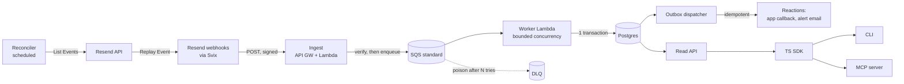

# Architecture

> **TEMPLATE — not ratified.** Bootstrap step 7 in [bootstrap-checklist.md](bootstrap-checklist.md). The preview content below is illustrative, drafted from [docs/idea.md](../docs/idea.md) without research. Nothing here is binding until this banner and the instructions comment are removed.

<!-- AGENT INSTRUCTIONS
Purpose: canonical home of ADRs, system shape, reliability core, Deferred (YAGNI), build order
(slices → M1/M2/M3) and risks. After step 13, docs/idea.md is a frozen RFC; decisions change here.
Consumers: wf-before-propose (ADRs by anchor, #deferred-yagni, #build-order-vertical-slices);
wf-after-propose-check (walks every ADR a change touches; BLOCKs a design that builds a categorical
reject); build-checklist.md (step 10) copies slice IDs and titles verbatim.
Inputs (read first): root AGENTS.md; about.md; decision-lens-suite.md; features.md; resend.md (RS-NN);
aws.md (AWS-NN, cost, budget alarm); integrations.md (Postgres host); docs/idea.md §5–7, §9, §10;
bootstrap-checklist.md → Owner calibration (binding: M1/M2/M3, no dates; deploy-and-keep).
Research: re-derive every ADR from the inputs, not from this preview. An ADR resting on vendor
behavior cites the RS-NN / AWS-NN fact, not the vendor page. If the fact is [Unverified], the ADR
names the conditional part and links the about.md open question.
Required structure (parser contract):
- Headings exactly `### ADR-NNN — Title` (em dash). Never renumber. Superseded body starts
  `**Superseded by [ADR-NNN](#anchor).** (Number retained; do not renumber.)`
- Body starts `**Accepted.**`. Here every ADR reads `**Proposed — preview.**`; flip it only after its
  evidence and citations are verified. Skills treat every `### ADR-` heading as ratified, so an open
  decision MUST NOT be an ADR: it goes under Open decisions or Risks & mitigations.
- One `Rejected:` line and one `**Evidence:**` line per ADR. Amendments inline:
  `*Amended YYYY-MM-DD — what and why.*`
- `## Deferred (YAGNI)` (Defer | Kind | Because | Tripwire; Kind temporal = countable tripwire,
  categorical = superseding ADR only) and `## Build order (vertical slices)` verbatim.
- Slice IDs match \d+[A-Za-z]?; quoted as `<ID> — <Title>`. Words marking something unsettled only
  under headings matching deferred | open question | risk | non-goal | out of scope.
Evidence rules: each reliability claim names a test or simulator invariant (idea §5.9) by path once
it exists, "pending — <kind> (slice N)" before. No possible evidence → delete or move to Open decisions.
Owner decisions to surface (one batched round, recommended pick each): (1) the M1 slice cut and how
the MVP CLI reads state (CONFLICT under Open decisions); (2) Lambda in or out of a VPC; (3) read API
runtime; (4) the hard monthly budget cap value (from aws.md).
Done when: each ADR Accepted with verified Evidence, or removed; slice IDs and milestones final;
every Deferred row has a Kind and, if temporal, a countable tripwire; banner and comment removed.
-->

Ledger's architecture decisions and their order of construction. Product context, personas and
non-goals live in [about.md](about.md); verified vendor behavior in [resend.md](resend.md) and
[aws.md](aws.md); provider choices in [integrations.md](integrations.md); columns in
[data-modeling.md](data-modeling.md); operations in [api-contract.md](api-contract.md). This doc
states how those are built and does not repeat them.

ADRs carry stable `ADR-NNN` ids that skills and specs cite. Never renumber; a superseded ADR keeps
its number and points forward.

## Accepted direction

- **Verify, then enqueue.** Ingest never touches the database; SQS is the buffer (ADR-001, ADR-002).
- **One immutable ledger, derived state.** `webhook_events` keyed on `svix_id` is the source of
  truth; projections are a pure function of the event set (ADR-003, ADR-004).
- **Postgres only**, with a transactional outbox for every side effect (ADR-005, ADR-006).
- **Recovery by id diff + replay** through the normal ingest path (ADR-007).
- **Serverless on one CDK stack per environment**, under the cost brake, deployed and kept (ADR-010).
- **One contract, many surfaces:** read API → SDK → CLI / MCP, one error shape (ADR-011).

## System shape

Source: [idea §5.1](../docs/idea.md#51-architecture-overview). **Source-of-truth rule (MUST).** `webhook_events` is the only authoritative store. `email_state`
and `recipient_state` are caches that MUST be rebuildable from `webhook_events` alone: dropping and
recomputing them yields identical rows. Any column that cannot be recomputed from the event set
MUST NOT live in a projection ([data-modeling.md → Projections are derived](data-modeling.md#projections-are-derived)).

## Reliability core

Every change is judged against these; they outrank evidence, cost, scope and polish ([decision lens](../AGENTS.md#decision-lens--evidence-over-claims-right-sized)).

| Invariant | Carried by | Evidence | Design test (MUST) |
| --- | --- | --- | --- |
| **No loss** — every event Resend produced for the webhook reaches `webhook_events` | ADR-001, 004, 007, 008 | pending — sim invariant 1; `--chaos db-outage`; "down > 28h" integration test (slices 2, 3) | A change MUST NOT return `2xx` to Resend before the event is durably enqueued, and MUST NOT drop a message without it reaching the DLQ |
| **No duplicate effects** — at-least-once delivery, exactly-once effects | ADR-004, 006 | pending — sim invariant 3; `--chaos worker-crash` (slice 5) | Every side effect MUST be an outbox row with a `dedupe_key`, written in the event's transaction; no I/O to a third party inside the worker transaction |
| **Order independence** — any arrival order and duplication give the same state | ADR-003 | pending — fast-check properties 1–4 ([idea §5.4](../docs/idea.md#54-order-independent-projections)); sim invariant 2 (slices 0, 1) | Projection code MUST NOT read `received_at`, prior projection state or arrival sequence |

## Decisions

### ADR-001 — Verify, then enqueue

**Proposed — preview.** Ingest does only local work: verify signature and timestamp, read `type`,
enqueue `{svixId, receivedAt, rawBody, headers subset}`, return `200`. `401` on bad signature, `503`
when the enqueue fails so Resend retries. Ingest MUST NOT depend on the database.
Rejected: writing to Postgres in the request path (DB outage becomes failed deliveries and retry storms).
**Evidence:** pending — unit tests for the three responses; `--chaos db-outage` keeps ingest at `200` (slice 2). Source: [idea §5.1–5.2](../docs/idea.md#52-ingest).

### ADR-002 — SQS standard, not FIFO

**Proposed — preview.** A standard queue with the maximum retention, plus a DLQ. Resend's deliveries
are not ordered, so FIFO would buy queue-arrival order that means nothing (ADR-003 makes order irrelevant).
Rejected: SQS FIFO (throughput cost, false sense of correctness); Kinesis/Kafka (always-on cost).
**Evidence:** pending — `--shuffle` and `--duplicates` sim runs pass on the standard queue (slice 2). Source: [idea §5.3](../docs/idea.md#53-worker-and-the-event-ledger).

### ADR-003 — Projection is a pure function of the event set

**Proposed — preview.** `projectEmail(events)` sorts by `(event_created_at, rank(type), svix_id)` and
folds; it is recomputed from the full event set on every new event. Status follows outcome precedence,
not recency: terminal negatives (`bounced`/`failed`/`suppressed`) outrank `delivered`. Opens and
clicks are counters plus first/last timestamps. `projectRecipient` derives from email states.
Rejected: incremental `UPDATE status = new` (correctness depends on arrival order).
**Evidence:** pending — fast-check permutation, idempotence, monotonicity and oracle properties (slice 0). Source: [idea §5.4](../docs/idea.md#54-order-independent-projections), [§9](../docs/idea.md#9-general-questions).

### ADR-004 — Immutable ledger keyed on `svix_id`, one transaction per message

**Proposed — preview.** Per message, one transaction: insert into `webhook_events` `ON CONFLICT
(svix_id) DO NOTHING`; on conflict, commit as a duplicate; otherwise lock the email's `email_state`
row, recompute projections, insert outbox rows, commit. A crash at any point is either nothing or
everything. Unknown event types are stored raw, skipped by projections and counted.
Rejected: dedupe on `(email_id, type)` (collapses distinct events); separate transactions per step.
**Evidence:** pending — Testcontainers integration test for crash-between-steps and duplicate insert; sim invariant 1 (slice 1). Source: [idea §5.3](../docs/idea.md#53-worker-and-the-event-ledger), [RS-NN: replay keeps `svix-id`](resend.md).

### ADR-005 — Postgres only

**Proposed — preview.** One Postgres database holds ledger, projections, outbox and run records.
The workload is transactional (dedupe, row locks, outbox in the same transaction). Host choice lives
in [integrations.md](integrations.md).
Rejected: multi-database connectors (Ingester's job); an analytics store; DynamoDB (no multi-row transactions with the outbox at this shape).
**Evidence:** pending — n/a beyond ADR-004's tests; this is a scope decision. Source: [idea §9](../docs/idea.md#9-general-questions).

### ADR-006 — Transactional outbox for reactions

**Proposed — preview.** Reactions are outbox rows with a unique `dedupe_key`, written in the causing
event's transaction and delivered by a dispatcher with retries and backoff. Alert emails pass a Resend
idempotency key derived from `dedupe_key`; app callbacks are signed, with stable ids.
Rejected: calling third parties from the worker; dedupe in memory.
**Evidence:** pending — `--chaos worker-crash` yields no duplicate alert; sim invariant 3 (slice 5). Source: [idea §5.6](../docs/idea.md#56-reactions-via-a-transactional-outbox), [RS-NN: idempotency keys](resend.md).

### ADR-007 — Recovery by id diff and replay through ingest

**Proposed — preview.** The reconciler checks the webhook is enabled, pages List Events past a grace
window up to a lookback horizon, diffs ids against `webhook_events`, and replays the missing ones. A
replay re-enters through ingest, so verification and dedupe apply unchanged. One failed replay never
aborts a run. Each run writes a `reconcile_runs` row.
Rejected: a special write path that inserts fetched payloads directly (bypasses verification).
**Evidence:** pending — "down > 28h" and "webhook disabled" integration tests against a fake Resend API (slice 3). Source: [idea §5.5](../docs/idea.md#55-reconciler-recovering-missed-events).

### ADR-008 — Backpressure: bounded concurrency, partial batch failure, DLQ

**Proposed — preview.** The worker's SQS event source uses maximum concurrency (the backpressure
valve), `ReportBatchItemFailures`, and a DLQ after `maxReceiveCount`. Bursts become queue depth,
not connection errors. DLQ messages are inspected and redriven by an `operate` action.
Rejected: unbounded concurrency; whole-batch retry.
**Evidence:** pending — `--burst 10000/10s` drains with zero loss; poison-message integration test (slice 2). Source: [idea §5.3](../docs/idea.md#53-worker-and-the-event-ledger), [AWS-NN](aws.md).

### ADR-009 — Multi-secret verification and timestamp tolerance

**Proposed — preview.** Ingest verifies against a list of active signing secrets so rotation has no
gap, and rejects `svix-timestamp` outside the tolerance. Whether multiple secrets are required or
only defensive depends on Resend's rotation semantics ([about.md → Open questions](about.md#open-questions)).
Rejected: a single secret with a redeploy on rotation.
**Evidence:** pending — unit tests for old/new secret overlap and forged/stale requests (slice 3). Source: [idea §5.2](../docs/idea.md#52-ingest).

### ADR-010 — Serverless, one CDK stack per environment

**Proposed — preview.** API Gateway HTTP API, Lambda, SQS, EventBridge Scheduler, Secrets Manager,
CloudWatch; one CDK stack per environment, deployed and kept up until the owner tears it down. No
always-on resources without a measured reason. Budget alarms with a hard monthly cap are part of the
stack, not polish. One command destroys everything.
Rejected: containers for the event path; NAT gateways; provisioned RDS.
**Evidence:** pending — `cdk destroy` leaves nothing billable; idle-cost measurement recorded in [aws.md](aws.md) (slice 2). Source: [idea §5.8](../docs/idea.md#58-infrastructure-and-operations).

### ADR-011 — One contract, many surfaces

**Proposed — preview.** The read API is described by OpenAPI and validated with Zod; the SDK is
generated types plus a thin client; the CLI and MCP server are built only on the SDK. One error shape
everywhere (`code`, `message`, `hint`, `docs`). Bearer tokens carry `read` or `operate` scope; MCP
operate tools are not registered without `operate`.
Rejected: CLI or MCP reading the database directly; per-surface error formats.
**Evidence:** pending — contract tests SDK ↔ API; MCP tool-registration test per scope (slice 4). Source: [idea §5.7](../docs/idea.md#57-interfaces-read-api-sdk-cli-mcp).

### ADR-012 — `resend-client` is the sole Resend API caller

**Proposed — preview.** Every Resend API call goes through `packages/resend-client`, which owns the
shared 10 req/s budget, honors `ratelimit-*` and `retry-after`, and leaves headroom for the team's
sending traffic.
Rejected: calling the `resend` SDK from apps directly.
**Evidence:** pending — fake-API test: a 429 storm backs off and the run completes (slice 3). Source: [idea §5.5](../docs/idea.md#55-reconciler-recovering-missed-events), [RS-NN: rate limit](resend.md).

### ADR-013 — Pure core and local mode

**Proposed — preview.** `packages/core` imports nothing from AWS, Postgres or Resend. A local mode
swaps SQS for a Postgres-backed queue (`FOR UPDATE SKIP LOCKED`) so the system runs with
`docker compose up` and no AWS account.
Rejected: AWS-only development (LocalStack as the only local path).
**Evidence:** pending — lint rule on `packages/core` imports (slice 0); sim invariants pass in local mode (slice 2B). Source: [idea §6.2](../docs/idea.md#62-repository-layout).

### ADR-014 — Raw-payload retention and redaction

**Proposed — preview.** A configurable job redacts personal data in raw payloads after N days.
Redaction MUST keep every field projections read, so the source-of-truth rule survives; PII in
projections follows [data-modeling.md → PII & retention](data-modeling.md#pii--retention).
Rejected: deleting ledger rows (breaks recovery diffing and rebuilds).
**Evidence:** pending — integration test: rebuild after redaction yields identical projection status (slice 6). Source: [idea §6.3](../docs/idea.md#63-data-model-initial).

## Technology

| Concern | Choice | Note |
| --- | --- | --- |
| Language / runtime | TypeScript (strict), Node.js LTS, pnpm workspaces | Resend's public stack |
| DB / migrations | Postgres, Drizzle ORM + drizzle-kit | Expand/contract only |
| Validation | Zod | Requests, responses, webhook payloads |
| Tests | Vitest, fast-check, Testcontainers | Property tests are first-class |
| Lint / format | Biome | |
| Logging / metrics | Winston JSON; CloudWatch EMF | `svix_id`, `email_id`, `type` on every line |
| Resend | `resend` Node SDK, only inside `packages/resend-client` | ADR-012 |
| Infra / CI | AWS CDK, GitHub Actions | ADR-010 |
| MCP | Official MCP TypeScript SDK | ADR-011 |

## Cost envelope

Cost shape, per-service numbers and the budget-alarm design are canonical in [aws.md](aws.md). Posture:
**deploy, record, keep** — the stack stays up until the owner tears it down, so idle cost MUST be near
zero and the hard monthly cap MUST alarm before it is reached. A resource with idle cost needs a
measured reason in an ADR.

## Deferred (YAGNI)

| Defer | Kind | Because | Tripwire |
| --- | --- | --- | --- |
| SQS FIFO | categorical | Arrival order is meaningless (ADR-002, ADR-003) | Superseding ADR only |
| Multi-database connectors, warehouse loading | categorical | Non-goal; the Ingester covers it ([about.md → Non-goals](about.md#non-goals--out-of-scope)) | Superseding ADR only |
| Multi-tenant hosting | categorical | Self-hosted, single team | Superseding ADR only |
| Kafka / Kinesis / event-sourcing framework | categorical | The ledger table is the log; always-on cost | Superseding ADR only |
| Upstream PRs to the Webhook Ingester | categorical | Not planned (owner calibration) | Owner reverses it |
| Projections for non-email events | temporal | Stored raw; no consumer yet | First reaction or query that needs contact/domain state |
| Inngest worker adapter | temporal | Comparison only; no claim depends on it | Owner schedules it after M2 closes |
| Minimal read-only web UI | temporal | CLI + MCP answer the jobs | A reviewer walkthrough fails on a job CLI + MCP cannot do |
| RDS Proxy / connection pooler service | temporal | Bounded concurrency caps connections (ADR-008) | Measured connection errors in a `--burst` run |

## Build order (vertical slices)

A slice is a small, independently shippable v0 with its own tests ([idea §7](../docs/idea.md#7-implementation-plan)).
[build-checklist.md](build-checklist.md) is the progress layer over this list and takes its IDs and
titles verbatim. Preview mapping; the M1 cut is an owner decision (see Open decisions).

| Slice | Ships (preview) | Milestone |
| --- | --- | --- |
| 0 — Foundations | Monorepo, Biome, Vitest, CI, `pnpm verify`; `packages/core` with `projectEmail` + property tests | M1 |
| 1 — Local v0 | Local ingest → ledger transaction → projections; Drizzle migrations; `sim` with duplicates + shuffle | M1 |
| 2 — Durable ingest | SQS + DLQ + worker; CDK stack deployed; metrics, alarms, budget cap; runbook v1 | M1 |
| 2B — Local-mode queue & docker compose | Postgres-backed queue; `docker compose up` runs the whole system | M2 |
| 3 — Recovery | Reconciler; multi-secret verification; `resend-client` rate limiting | M1 |
| 4 — Read API & SDK | OpenAPI read API, scopes, error shape; generated SDK | M1 (minimal) / M2 |
| 4B — CLI | `ledger email`, `recipient`, `gaps`, `reconcile`, `dlq` with `--json` | M1 (reads) / M2 |
| 4C — MCP server | Read tools; opt-in operate tools | M2 |
| 5 — Reactions | Outbox + dispatcher; app callback; alert email with idempotency keys | M2 |
| 6 — Polish | `docs/results.md`, runbook complete, README quick start, retention job | M2 |

**M3 — Stretch** (no slice IDs yet): SDK and CLI published to npm with semver; real AWS load numbers
from the 10k burst; a learning log of the AWS and distributed-systems decisions.

## Risks & mitigations

| Risk | Mitigation |
| --- | --- |
| Cost runaway while the stack is kept up | Hard budget cap + alarm in the stack (ADR-010); no idle resources |
| Concurrent workers updating the same `recipient_state` from different emails | Lock recipient rows in sorted-address order after the email lock; recompute from all its emails; concurrency integration test |
| Postgres connection exhaustion under burst | Event-source max concurrency (ADR-008); small per-Lambda pool |
| Webhook auto-disabled and nobody notices | Reconciler enabled-check alarms with `webhook_disabled` (ADR-007) |
| Reconcile competes with the team's sending for 10 req/s | `resend-client` budget with headroom (ADR-012); cadence is an open question in about.md |
| Replayed deliveries rejected by the timestamp tolerance | Verify against [resend.md](resend.md) whether a replay is re-signed with a fresh timestamp before slice 3 |
| Redaction breaks projection rebuilds | ADR-014 keeps projection inputs; rebuild-after-redaction test |
| Outcome precedence wrong for async bounces or `created_at` semantics | Oracle property test; idea §10 Q3–Q4 carried to [about.md → Open questions](about.md#open-questions) |
| PII leaks into a public repo or logs | `@resend.dev` fixtures only; log redaction; [data-modeling.md → PII & retention](data-modeling.md#pii--retention) |

## Open decisions

- **Postgres host** — owned by [integrations.md](integrations.md) (step 6). Drives the next item.
- **Lambda inside or outside a VPC.** A VPC-only database needs NAT or VPC endpoints for SQS,
  Secrets Manager and Resend's API; NAT breaks the cost brake. Preview lean: outside a VPC, TLS to a
  managed host, if integrations.md picks one that allows it.
- **Read API runtime.** Preview lean: Lambda behind the same HTTP API; a container only on the
  Deferred tripwire.
- **CONFLICT — how the M1 CLI reads state.** [idea §7](../docs/idea.md#7-implementation-plan) Phase 1
  has `ledger email` / `ledger recipient` read the database directly, while
  [root AGENTS.md → Module boundaries](../AGENTS.md#module-boundaries) says the CLI is built only on
  `packages/sdk`. M1 requires a usable CLI. Options: (a) pull a minimal read API + SDK
  (`GET /emails/:id`, `GET /recipients/:address`) and the matching CLI reads into M1, as the table
  above previews — recommended, it keeps one contract; (b) a dev-only inspection script outside
  `apps/cli` for slice 1, with the real CLI in M2. Owner rules at step 7.
