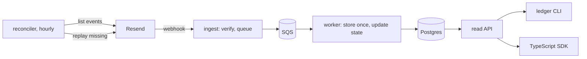

# Ledger

Ledger keeps a correct record of your [Resend](https://resend.com) email events. It stores every
webhook once, works out what's true about each email and recipient right now, and goes back for the
events your endpoint missed.

It's an independent open-source project, not affiliated with or endorsed by Resend.

It's a proof of concept, and it's running: deployed on AWS, receiving a real Resend account's
webhooks. The [roadmap](#roadmap) has what comes next.

## Why webhooks alone aren't enough

Resend tells you what happens to your emails through webhooks. Catching them is easy. Knowing
what's true right now is not, because delivery in the real world is messy:

- You'll get the same event twice. Resend delivers at least once, and retries and replays repeat
  events ([RS-06, RS-08](.ai/resend.md#facts)).
- You'll get them out of order. Resend promises no order, so a late `email.delivered` can show up
  after the `email.bounced` it must never overwrite.
- You'll get them all at once. A broadcast is a burst, one webhook per recipient per event, and a
  database under pressure turns that burst into errors and more retries.
- And sometimes you won't get them at all. If your endpoint is down longer than Resend's retry
  schedule, about a day, those events are gone, and an endpoint that keeps failing gets disabled
  ([RS-09, RS-11](.ai/resend.md#facts)). Nothing tells you what you never stored.

## What it looks like

A support ticket comes in: "This customer never gets our emails." So you check the address:

```
$ ledger recipient bounced@resend.dev
recipient        bo*****@r*****.d**
deliverability   hard_bounced
since            2026-10-17T21:52:05.326Z
caused by        01a14bd9-c232-7222-8b8e-0ef322a1cbde
```

Hard-bounced. And Ledger tells you which email did it. Open that one:

```
$ ledger email 01a14bd9-c232-7222-8b8e-0ef322a1cbde
email       01a14bd9-c232-7222-8b8e-0ef322a1cbde
status      bounced
from        onb*******@r*****.d**
subject     Le**** s**** * **-U** re******
events      2, last 2026-10-17T21:52:05.326Z
opens       0
clicks      0

recipients
  bo*****@r*****.d**   bounced   2026-10-17T21:52:05.326Z   Permanent / General

timeline
  2026-10-17T21:52:04.950Z   email.sent      msg_3Kq8qFJLyIoFF0HH1MhZ3ZJcKWF
  2026-10-17T21:52:05.326Z   email.bounced   msg_3Kq8qFMdgo3E3Pg6KrtVAdDfTBv   Permanent / General
```

A permanent bounce. Sending to that address again won't work. Notice the asterisks, too: Ledger
masks every address, sender and subject, so support can answer the ticket without ever seeing
personal data.

Does the order events arrive in change the answer? It shouldn't. Here the complaint landed before
the delivery, and the email still reads `complained`. Ledger works out state from the whole set of
events, whichever one happened to show up last:

```
$ ledger email 01a14bd8-504a-7908-b8c6-52bd72f69ff0
email       01a14bd8-504a-7908-b8c6-52bd72f69ff0
status      complained
...
timeline
  2026-10-17T21:50:30.285Z   email.sent         msg_3Kq8eJzsBMY3ZFv7xtpBmGAVurX
  2026-10-17T21:50:30.794Z   email.complained   msg_3Kq8eLE9jSAXCSJlu4RZ70Ziobn
  2026-10-17T21:50:30.817Z   email.delivered    msg_3Kq8eL0sw5HcJFnLy1BUYfvaX2l
```

Then there's the on-call question: did we lose anything? `ledger health` shows the pipeline.
`ledger gaps` lists the recovery runs, each one comparing what Resend has with what Ledger stored:

```
$ ledger health
queue       0 visible, 0 in flight, oldest —
dlq         0 visible, 0 in flight
worker      enabled
database    reachable, 46.5 MB of 1.0 GB
reconcile   run 9 finished 2026-10-20T18:13:23.735Z, missing 0, replayed 0

$ ledger gaps --since 3h
  9   manual      dry run   2026-10-20T18:13:22.733Z   checked 6   missing 0   replayed 0   failed 0   ok
  8   manual                2026-10-20T18:13:15.634Z   checked 6   missing 2   replayed 2   failed 0   ok
  7   manual      dry run   2026-10-20T18:13:11.394Z   checked 6   missing 2   replayed 0   failed 0   ok
  6   scheduled             2026-10-20T18:00:11.522Z   checked 4   missing 0   replayed 0   failed 0   ok
```

Runs 7 to 9 are an outage I caused on purpose. I switched ingest off, sent one email, and let
Ledger miss both of its events. The dry run found them, the next run had Resend replay them, and
the last run confirmed nothing was left. You can run that check whenever you like. A dry run never
replays anything:

```
$ ledger reconcile --dry-run
ledger: reconcile run 10 started; follow it with ledger gaps.
run 10   manual   dry run
started    2026-10-20T18:37:35.859Z
finished   2026-10-20T18:37:38.746Z
horizon    2026-10-17T18:37:35.900Z → 2026-10-20T18:27:35.900Z
checked 6   missing 0   replayed 0   failed 0
```

And when something isn't there, the error tells you what to do about it. It's the same shape
everywhere, in the CLI, the SDK and the API, with a link to its [runbook](docs/runbook.md) entry:

```
$ ledger email does-not-exist --json
{
  "error": {
    "code": "email_not_found",
    "message": "No event has been recorded for this email id.",
    "hint": "Events may still be queued, or missed: run `ledger gaps`.",
    "docs": "https://github.com/phillippelevidad/resend-application/blob/main/docs/runbook.md#email_not_found"
  }
}
```

Everything above is real output. The bounce and the complaint came from live sends to Resend's test
addresses on 2026-10-17, the health and gaps from the deployed stack on 2026-10-20.

## What it guarantees

Claims are cheap, so each one links the test or the recorded run that backs it.

| Guarantee | Evidence |
| --- | --- |
| Only verified webhooks are accepted. Ingest checks the signature against every configured secret and returns `200` only after the event is queued | [create-ingest.test.ts](packages/ingest/src/create-ingest.test.ts), [ADR-001](.ai/architecture.md#adr-001--verify-then-enqueue) |
| Each event is stored once, keyed on its `svix-id`, however many times it arrives | [record-event.command.int.test.ts](packages/worker/src/record-event.command.int.test.ts) against real Postgres, simulator [invariant 1](sim/src/invariants/invariant-1.ts) |
| Email and recipient state comes out the same in any arrival order, with any number of duplicates | Property tests over every ordering: [project-email](packages/core/src/project-email.projection.prop.test.ts), [project-recipient](packages/core/src/project-recipient.projection.prop.test.ts); simulator [invariant 2](sim/src/invariants/invariant-2.ts) |
| A burst is absorbed. 10,000 signed events sent to the deployed stack in 16.8 s were all stored within 101 s, each once, with ingest p99 at 4.2 s | [ADR-008 → Evidence](.ai/architecture.md#adr-008--backpressure-bounded-concurrency-partial-batch-failure-dlq), [RS-U08](.ai/resend.md#unverified) |
| A database outage loses nothing. Ingest keeps answering `200`, the worker pauses, and the queue holds the events until the database is back | [ADR-015 → Evidence](.ai/architecture.md#adr-015--the-worker-pauses-its-own-event-source-on-a-database-outage) |
| One bad event doesn't block the rest. It moves to a dead-letter queue, and `ledger dlq redrive` sends it back | [poison-isolation.int.test.ts](packages/worker/src/poison-isolation.int.test.ts), simulator [invariant 4](sim/src/invariants/invariant-4.ts) |
| Missed events are recovered, hourly and on demand. An outage longer than Resend's retry schedule ends fully recovered with no duplicates | [recovery.int.test.ts](packages/reconciler/src/recovery.int.test.ts), the recorded gap drill in [ADR-007 → Evidence](.ai/architecture.md#adr-007--recovery-by-id-diff-and-replay-through-ingest) |
| Replaying an event Ledger already has changes nothing. A 41-hour-old event replayed from Resend was recognized as a duplicate | [RS-45](.ai/resend.md#facts) |
| No raw address or subject leaves the read API | Route-level redaction tests such as [get-email.route.int.test.ts](packages/api/src/get-email.route.int.test.ts) |
| The AWS bill has a ceiling. A budget alarm emails you, and a kill switch stops compute at the monthly cap | [guardrails.stack.test.ts](infra/src/guardrails.stack.test.ts), [aws.md → Budget alarms](.ai/aws.md#budget-alarms) |

The same goes for Resend itself. Every Resend behavior Ledger relies on is checked against Resend's
docs and cited in [resend.md](.ai/resend.md). Where the docs are silent, I tested it live on a real
account, or it's listed there as unverified.

## How it works



Ingest does as little as it can get away with. It checks the signature, puts the event on a queue
and answers. It never touches the database, so a struggling database can't hold
it up.

The worker does the real work. It stores each event in an append-only table, then recomputes the
email's and the recipient's state from all of their events, in the same transaction.

The reconciler is the safety net. Every hour, and whenever you ask, it asks Resend which events exist, compares their ids
with what's stored, and has Resend replay the missing ones. Recovered events come in through the
front door, so they're verified like any other.

It runs on AWS Lambda, API Gateway and SQS with Postgres, deployed with AWS CDK and written in
TypeScript. Everything is serverless and billed per use. No VPC, no NAT gateway, nothing running in
the background, and the CDK tests check that ([app.stack.test.ts](infra/src/app.stack.test.ts)).
The design decisions and their trade-offs are in [architecture.md](.ai/architecture.md), and the
[runbook](docs/runbook.md) has an entry for every alarm and error code.

## Roadmap

The proof of concept is done, and it's running right now: durable ingest on AWS, order-independent
state, recovery of missed events, alarms with a runbook, and the CLI and SDK over one read API.

Next up, the MVP:

- A local stack with `docker compose up`, so you can run everything without an AWS account.
- An MCP server, so an AI assistant can answer "why did this email fail?" with a read-only token.
- Reactions, such as calling your app or emailing you when an address hard-bounces, sent exactly
  once.
- A 15-minute quick start for deploying your own copy, and redaction of stored payloads after a
  retention period.

Then feature complete: the CLI and SDK on npm with semantic versioning, and a published load test
with its latency and cost.

The full plan is in the [build checklist](.ai/build-checklist.md).

## Ledger and the Webhook Ingester

Resend already has a [Webhook Ingester](https://resend.com/docs/webhooks/ingester). It verifies
webhooks and stores each event in your database, which answers "what happened?" Ledger picks up
where that leaves off: what's true now, and did we miss anything? The recovery approach is the same
one proposed in the Ingester's open
[PR #13](https://github.com/resend/resend-webhooks-ingester/pull/13). More in
[about.md → Positioning](.ai/about.md#positioning).

If you send a few hundred emails a day and a wrong status costs you nothing, you don't need this. A
simple webhook handler will do. Ledger is for transactional email (password resets, receipts,
alerts) where a wrong status turns into a support ticket. And for volumes where bounces and
complaints start to hurt your sender reputation.

## Try it yourself

### Run it locally

No AWS account needed for this one. You need Node.js 24, pnpm 10 (`corepack enable` picks the
version from `package.json`) and Docker.

```bash
git clone https://github.com/phillippelevidad/resend-application.git
cd resend-application
pnpm install
pnpm dev:full      # starts Postgres in Docker and the local server; prints LEDGER READY
```

`pnpm dev:full` writes a `.env.local` with generated keys and an access token. Then send it a
simulated history of emails, with duplicates and shuffled delivery order:

```bash
pnpm sim --seed 2026 --duplicates 0.3 --shuffle
```

The simulator signs each event the way Resend does and sends it to the local ingest. Then it checks
the result: every event stored once, and the state it expected. Same seed, same history:

```
history emails=8 events=36 duplicates=10 shuffled=true
sent requests=46 accepted=46
invariant 1 pass stored=36/36
invariant 2 pass emails=8 recipients=9
```

The CLI reads the same `.env.local`:

```bash
pnpm -s ledger health
pnpm -s ledger gaps
pnpm -s ledger --help
```

Locally there's no Resend account behind it, so `ledger reconcile` records a run that ends
`reconciler_not_configured`. `pnpm dev:stop` stops everything.

### Deploy it to your AWS account

You need an AWS account with [CDK bootstrapped](https://docs.aws.amazon.com/cdk/v2/guide/bootstrapping.html),
a Postgres database (the project uses [Neon](https://neon.tech)'s free plan) and a Resend account.

1. Run `pnpm db:setup` once to generate the hashing and token keys, then fill in the rest of
   `.env.local` from [.env.example](.env.example): the database URLs, the address for alarm
   emails, and a monthly budget.
2. Run `pnpm aws:deploy`. It migrates the database, deploys the stacks, and prints the ingest URL
   and a first access token.
3. In Resend, create a webhook pointing at the ingest URL. Put its signing secret in
   `LEDGER_DEPLOY_WEBHOOK_SECRETS`, and a `full_access` API key and the webhook's id in
   `LEDGER_DEPLOY_RESEND_API_KEY` and `LEDGER_DEPLOY_RESEND_WEBHOOK_ID`, then deploy again.
4. Point the CLI at the deployment with `LEDGER_URL` and `LEDGER_TOKEN`, and run
   `pnpm -s ledger health`.

`pnpm aws:teardown` removes everything. Every command and variable is described in
[AGENTS.md → Commands](AGENTS.md#commands).

### Work on it

```bash
pnpm check     # lint, typecheck and unit tests
pnpm verify    # the full gate CI runs, including the Postgres integration tests (needs Docker)
```

The product and design docs live in [`.ai/`](.ai/AGENTS.md). Start with
[about.md](.ai/about.md) and [architecture.md](.ai/architecture.md).

## License

[MIT](LICENSE)
