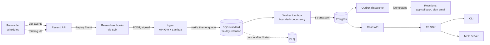

# Ledger: a reliable email-event ledger for Resend webhooks

| | |
|---|---|
| **Status** | Accepted, frozen 2026-10-15 |
| **Working name** | Ledger (not affiliated with or endorsed by Resend) |
| **Format** | Follows the RFC structure Resend describes in its [public handbook](https://resend.com/handbook/engineering/how-we-use-rfcs) |
| **Last verified against Resend docs** | 2026-10-15 |

> **Frozen RFC. Living decisions are in [`.ai/`](../.ai/AGENTS.md).** This document records the
> design as accepted on 2026-10-15 and is no longer edited. Verified facts live in
> [resend.md](../.ai/resend.md) and [aws.md](../.ai/aws.md), decisions in the ADRs of
> [architecture.md](../.ai/architecture.md), the build order in
> [build-checklist.md](../.ai/build-checklist.md), and open questions in
> [about.md](../.ai/about.md#open-questions). Where this document and `.ai/` disagree, `.ai/` wins.
> For example, ADR-015 replaces the database-outage row of §6.4, and the slices replace the phases
> of §7.

> **Why this exists.** Ledger is a portfolio project, built as part of an application to two
> engineering roles at Resend: **Backend Engineer** and **Software Engineer, Developer Tools**.
> Instead of a generic demo, it tries to solve a real problem Resend's customers face, using
> Resend's newest public APIs the way a customer would. It's an independent project, not
> affiliated with or endorsed by Resend.

## TL;DR

Resend tells your application what happened to your emails through webhooks. Receiving them
is easy. Turning them into **correct, current, queryable state** and **safe reactions** is the
hard part. Webhooks can arrive twice, out of order, in bursts of thousands after a broadcast, or
not at all if your endpoint is down longer than the retry schedule.

Ledger is a small, self-hosted service that:

1. **Accepts** Resend webhooks quickly and durably, so a slow database never turns into failed
   deliveries and retry storms.
2. **Records** every event exactly once, then **projects** it into per-email and per-recipient
   state that is the same no matter what order or how many times events arrive.
3. **Reacts** to events (for example "this address hard-bounced") without running the same
   side effect twice.
4. **Recovers** events it missed, using Resend's Headless Webhook API.
5. **Answers questions** like "did this user get the password-reset email, and if not, why?"
   from a CLI, a typed SDK, or an MCP server that an AI agent can use safely.

It runs on AWS (API Gateway, Lambda, SQS, Postgres), deployed with AWS CDK, written in TypeScript.

---

## 1. Purpose

### The problem

A team sending email through Resend usually needs three things from webhook events:

- **State:** "What is the delivery status of email X?" and "Is this recipient address still
  deliverable?"
- **Reactions:** "When an address hard-bounces or complains, stop emailing it from our app and
  flag the user." "Alert us when the bounce rate spikes."
- **Answers:** Support and on-call need to explain specific deliveries quickly, increasingly
  through an AI agent.

The naive handler (`POST /webhook` → `UPDATE emails SET status = ...`) gets all three wrong under
real-world conditions:

| Condition | What breaks in a naive handler |
|---|---|
| Duplicate delivery (retries, manual replays) | Side effects run twice: two alerts, double counters |
| Out-of-order arrival | A late `email.delivered` overwrites an earlier-arriving `email.bounced`, so status goes backwards |
| Traffic spikes (one broadcast can produce a burst of webhooks for each recipient) | DB connection exhaustion → 5xx → Resend retries → more load |
| Endpoint or DB down longer than the retry schedule (~28h) | Events are silently lost. Nothing reports the gap |
| Poison payloads / unknown event types | One bad event blocks or crashes the handler |
| Concurrent workers on the same email | Lost updates on the same row |

### The opportunity

Resend has recently made the missing pieces available. The **Headless Webhook API** (List Events,
Retrieve Event, List Attempts, Replay Event, Rotate Signing Secret) makes recovery and inspection
fully programmatic. The [Headless Dashboard Initiative](https://resend.com/blog/headless-dashboard-initiative)
commits to *"everything the dashboard can do should also be available programmatically"*, for
humans and agents alike. Ledger is a reference for what a production-grade consumer of those APIs
looks like.

---

## 2. Background

### 2.1 How Resend webhooks behave (verified facts)

| Fact | Source |
|---|---|
| Webhooks are delivered via Svix and signed. Headers: `svix-id`, `svix-timestamp`, `svix-signature`. Verification must use the **raw** body. | [Verify webhook requests](https://resend.com/docs/webhooks/verify-webhooks-requests) |
| Retry schedule after a failed attempt: immediately, 5s, 5m, 30m, 2h, 5h, 10h, 10h (≈ 27.6h in total). | [Retries and replays](https://resend.com/docs/webhooks/retries-and-replays) |
| Endpoints that keep failing are **auto-disabled**, and the team gets an email. Disabled endpoints receive nothing, including replays. | [Retries and replays](https://resend.com/docs/webhooks/retries-and-replays) |
| Both failed and succeeded events can be replayed. A replay adds one delivery and doesn't change the retry schedule. | [Replay Event](https://resend.com/docs/api-reference/webhooks/replay-event) |
| List Events returns event `id`, `type`, `created_at`, `status` (`success`, `failed`, `attempting`, `pending`), newest first, cursor-paginated with `after`, max 100 per page. | [List Events](https://resend.com/docs/api-reference/webhooks/list-events) |
| Retrieve Event returns the full `payload` and `next_attempt_at`. List Attempts returns HTTP status and response body per attempt. | [Retrieve Event](https://resend.com/docs/api-reference/webhooks/get-event), [List Attempts](https://resend.com/docs/api-reference/webhooks/list-event-attempts) |
| A replayed event carries the **same `svix-id`** as the original, and that id equals the List Events `id` (`msg_...`). New events take ~8s to appear in List Events. | Verified by a community contributor against the live API in [resend-webhooks-ingester#12](https://github.com/resend/resend-webhooks-ingester/issues/12) |
| API rate limit: **10 requests/second per team**, shared across all API keys. IETF `ratelimit-*` and `retry-after` headers. | [Usage limits](https://resend.com/docs/api-reference/rate-limit) |
| Resend retains email data for **30 days** (more on Enterprise). | [How to store webhooks data](https://resend.com/docs/webhooks/how-to-store-webhooks-data) |
| Email event types: `email.scheduled`, `sent`, `delivered`, `delivery_delayed`, `bounced`, `failed`, `suppressed`, `complained`, `opened`, `clicked`, `received`. Also contact, domain, topic, suppression and inbox events. | [Event types](https://resend.com/docs/webhooks/event-types) |
| Bounce payloads include `bounce.type` (e.g. `Permanent`) and `bounce.subType` (e.g. `Suppressed`). | [email.bounced](https://resend.com/docs/webhooks/emails/bounced) |
| The CLI can tunnel real webhooks to localhost: `resend webhooks listen`. | [Resend CLI 2.0](https://resend.com/blog/resend-cli-2) |

### 2.2 What already exists: the Resend Webhook Ingester

Resend maintains an open-source [Webhook Ingester](https://resend.com/docs/webhooks/ingester): a
Next.js app that verifies signatures and inserts each event as a row in your database
(`ON CONFLICT (svix_id) DO NOTHING`), with connectors for nine databases. An open community PR
([#13](https://github.com/resend/resend-webhooks-ingester/pull/13)) adds a `/reconcile` route that
replays events missing from the database.

The Ingester answers **"what happened?"**: an append-only log. Ledger is designed to answer the
questions that come next, and to **complement** the Ingester, not compete with it:

| Capability | Ingester (+ PR #13) | Ledger |
|---|---|---|
| Signature verification | ✅ | ✅ (plus multiple active secrets during rotation) |
| Idempotent raw storage | ✅ | ✅ |
| Recover missed events | ✅ (PR #13) | ✅ (same approach, replays land in the queue path) |
| Many database connectors | ✅ | ❌ Postgres only (non-goal) |
| Ingest decoupled from storage (DB outage ≠ failed delivery) | ❌ writes in the request path | ✅ queue buffer, up to 14 days |
| Backpressure under spikes | ❌ | ✅ bounded worker concurrency |
| Current per-email state, independent of arrival order | ❌ | ✅ |
| Per-recipient deliverability state | ❌ | ✅ |
| Safe side effects (outbox, idempotent reactions) | ❌ | ✅ |
| Poison-message isolation (DLQ + redrive) | ❌ | ✅ |
| Operator and agent interfaces (CLI, SDK, MCP) | ❌ | ✅ |
| Proven failure behavior (property tests, chaos harness) | Unit + integration | ✅ first-class deliverable |

Where Ledger's work could help the Ingester upstream (for example, the order-independent projection
as an answer to the timeline request in [#8](https://github.com/resend/resend-webhooks-ingester/issues/8)),
we'll offer it there rather than fork the ecosystem. See [Open questions](#10-open-questions).

---

## 3. Goals and non-goals

### Goals

1. **No lost events.** Every event Resend produced for the configured webhook ends up in the
   ledger, even after an outage longer than the retry window, within a bounded and observable
   recovery time.
2. **Exactly-once effects on top of at-least-once delivery.** Duplicates are absorbed. Every
   reaction has an idempotency key.
3. **Order-independent state.** For any set of events, every arrival order and any amount of
   duplication give the same projected state. Proven with property-based tests.
4. **Predictable under load.** Ingest stays fast and available during bursts. Processing rate is
   explicitly bounded to protect the database.
5. **Operable.** Meaningful metrics and alarms, a runbook, safe deploys, infrastructure as code.
6. **Useful to humans and agents.** A CLI, a typed SDK and an MCP server with clear errors and
   least-privilege defaults.
7. **v0 first.** Every phase is usable on its own. Small PRs.

### Non-goals

- Multi-database connectors, warehouse loading, or analytics dashboards (the Ingester and tools
  like Tinybird cover these).
- Multi-tenant SaaS hosting. Ledger is self-hosted, single team.
- Sending email, except operational alerts (which go through Resend, see §5.6).
- A full web UI. A minimal read-only page is a possible stretch (§10).
- Projections for non-email events in v0. Contact, domain, topic and inbox events are stored raw
  and can be projected later.

---

## 4. Users and jobs to be done

| User | Job | Primary surface |
|---|---|---|
| **Application developer** | "My app should know when an address stops being deliverable, without me writing webhook plumbing." | Recipient state via SDK / HTTP, reaction hooks |
| **Support / on-call engineer** | "A customer says they never got the reset email. Show me exactly what happened, fast." | CLI (`ledger email`, `ledger recipient`) |
| **Operator** | "We had an outage. Did we lose anything? Recover it and prove it." | CLI (`ledger gaps`, `ledger reconcile`), metrics, alarms |
| **AI agent** (acting for any of the above) | "Explain why this delivery failed, and suggest a next step, without being able to break anything." | MCP server, read-only by default |

---

## 5. Proposal

### 5.1 Architecture overview



The key decision is **verify, then enqueue; don't write to the database in the request path**:

- The ingest Lambda does only cheap, local work: check the signature and timestamp, parse just
  enough to read `type`, enqueue, return `200`. Typical latency should be well below Svix's
  timeout. It doesn't depend on the database at all.
- A database outage therefore **does not** fail deliveries. Events wait in SQS (retention up to 14
  days, versus Resend's ~28h retry window), and the worker drains them once the database is back.
  The queue extends the recovery window from ~28h to ~14 days, without any reconciliation.
- Unverified requests are rejected before they reach the queue, so the queue can't be flooded
  with junk.

### 5.2 Ingest

- `POST /webhooks/resend` (API Gateway HTTP API → Lambda, raw body preserved).
- Verify with the Resend SDK (`resend.webhooks.verify`) / Svix, against a **list** of active signing
  secrets, so secret rotation has no downtime window (§7, open question on Resend's rotation
  semantics).
- Reject `svix-timestamp` outside the tolerance (Svix default 5 minutes) → protection against
  replay attacks.
- Enqueue `{ svixId, receivedAt, rawBody, headers subset }`. The raw body is kept so the worker
  stores exactly what Resend signed.
- Responses: `200` on enqueue, `401` on bad signature (so Resend does not retry forever on a
  misconfiguration, and an alarm fires), `503` if the enqueue fails (Resend retries, which is the
  correct behavior).

### 5.3 Worker and the event ledger

The SQS event source mapping invokes the worker with batches and **ReportBatchItemFailures**, so
one bad message doesn't redeliver the whole batch. **Maximum concurrency** on the event source
mapping caps how many workers hit Postgres at once. This is the backpressure valve. Bursts become
queue depth, not database connection errors.

For each message, in **one database transaction**:

1. `INSERT INTO webhook_events ... ON CONFLICT (svix_id) DO NOTHING`.
2. If the row already existed → **duplicate**. Commit, count it, done.
3. Otherwise, lock the affected email (`SELECT ... FOR UPDATE` on `email_state`, created on first
   sight) so concurrent workers on the same email serialize, while different emails proceed in
   parallel.
4. Recompute the projections for that email (§5.4) and upsert `email_state` and `recipient_state`.
5. Insert any reactions into `outbox` with a unique `dedupe_key`.
6. Commit.

Because every step happens in one transaction keyed on `svix_id`, a worker crash at any point is
safe. Either nothing committed (the message is retried) or everything did (the retry is a
duplicate). Messages that fail N times go to the **DLQ** with the error attached. `ledger dlq
inspect` and `ledger dlq redrive` handle them after a fix.

Unknown event types are stored raw, skipped by projections, and counted in a metric. New event
types never break ingestion.

**Why not SQS FIFO?** FIFO orders messages by *arrival at our queue*, but Resend's deliveries are
not ordered in the first place (retries and replays arrive whenever they arrive). FIFO would cost
throughput and give a false sense of correctness. Ledger makes ordering irrelevant (§5.4).

### 5.4 Order-independent projections

**Principle:** state is a pure function of the *set* of events seen for an email, never of the
sequence in which they arrived.

```ts
// packages/core: no I/O, fully unit- and property-tested
projectEmail(events: EmailEvent[]): EmailState
```

`projectEmail` sorts by `(created_at, rank(type), svix_id)` and folds. Recomputing from the full
event set on every new event is O(events per email). That number is small for lifecycle events.
Opens and clicks are kept as counters and first/last timestamps, so they don't grow the state.

**Delivery status** is decided by outcome precedence, not recency:

| Rank | Status | Notes |
|---|---|---|
| 0 | `scheduled` | |
| 1 | `sent` | Accepted by Resend |
| 2 | `delivery_delayed` | Transient. Superseded by any later outcome |
| 3 | `delivered` | |
| 4 | `bounced` / `failed` / `suppressed` | Terminal negative. A bounce **can** follow a delivered event (asynchronous bounce), and must win |

Orthogonal flags are kept alongside status, not inside it: `complained_at`, `first_opened_at`,
`open_count`, `first_clicked_at`, `click_count`, `last_event_at`.

**Recipient state** (per address, lowercased) is derived from email states:
`deliverability ∈ {ok, soft_bouncing, hard_bounced, complained, suppressed}`, with timestamps and
the `email_id` that caused each transition. That's what an application checks before sending.

**Properties we test with `fast-check`:**

1. Permutation invariance: any shuffle of an event set gives the same state.
2. Idempotence: duplicating any subset of events gives the same state.
3. Monotonicity: adding a terminal negative event never yields `delivered`.
4. Agreement with an oracle: the projection matches a deliberately simple reference
   implementation on generated histories.

### 5.5 Reconciler: recovering missed events

This runs on a schedule (EventBridge Scheduler, e.g. every 15 min) and on demand (`ledger reconcile`):

1. Check that the webhook is **enabled** (Retrieve Webhook). If it's disabled, alarm and stop with a
   clear message, because replays to a disabled endpoint are not delivered.
2. Page through **List Events** (newest first). Skip events younger than a grace window (default
   10 min, since they may still be retrying). Stop at a lookback horizon (default 3 days, longer than
   the ~28h retry schedule).
3. Batch-check which ids are missing from `webhook_events`.
4. **Replay** each missing event. The replay comes back through normal ingest, so verification
   and dedup apply unchanged. No special write path.
5. Respect `ratelimit-remaining`, `ratelimit-reset` and `retry-after`, and leave headroom, because
   the 10 req/s limit is shared with the team's sending traffic. One failed replay is counted and
   skipped and never aborts the run.
6. Record a `reconcile_runs` row `{checked, missing, replayed, failed, duration}` and emit the
   metrics. A non-zero `missing` is a signal worth alerting on, because it means something upstream
   failed.

This mirrors the approach in Ingester PR #13 (ids compared, not delivery status, which also catches
"acknowledged with 200 but never stored"), adapted to a queue-based ingest.

### 5.6 Reactions via a transactional outbox

Reactions are written to `outbox` **in the same transaction** as the event that caused them, then
delivered by a dispatcher with retries and backoff. Each has a `dedupe_key`, e.g.
`recipient.hard_bounced:<address>:<svix_id>`.

Built-in reactions for v0:

- **App callback** (optional): a signed HTTP POST to the developer's application, e.g. "this
  address is now `hard_bounced`". Ledger becomes a webhook *producer* and follows the same rules
  it expects from Resend: signed payloads, retries, stable ids.
- **Operational alert email** sent **through Resend**, using Resend's
  [idempotency keys](https://resend.com/docs/dashboard/emails/idempotency-keys) derived from the
  outbox `dedupe_key`, so a retried dispatch cannot send two alerts. Triggered by thresholds such
  as bounce or complaint rate over a window, DLQ depth, or reconcile gaps.

### 5.7 Interfaces: read API, SDK, CLI, MCP

One contract, many surfaces. Ledger follows the same idea as Resend's headless direction.

**Read API** (HTTP, OpenAPI-described, Zod-validated, bearer-token auth with `read` / `operate` scopes):

| Endpoint | Purpose |
|---|---|
| `GET /emails/:emailId` | Projected state + full event timeline |
| `GET /recipients/:address` | Deliverability state and the emails that caused it |
| `GET /gaps` | Latest reconcile results |
| `GET /health` | Queue depth, DLQ depth, oldest message age, last reconcile |
| `POST /reconcile` | Trigger a run (`operate` scope) |
| `POST /dlq/redrive` | Redrive DLQ messages (`operate` scope) |

**Errors** follow a single shape everywhere: `{ "error": { "code", "message", "hint", "docs" } }`.
For example: `code: "webhook_disabled"`, with a hint to re-enable it in the Resend dashboard and
run `ledger reconcile` afterwards.

**TS SDK:** generated types from the OpenAPI spec plus a thin hand-written client with retries
for idempotent reads only.

**CLI** (built on the SDK), designed for support and on-call:

```text
$ ledger email 56761188-7520-42d8-8898-ff6fc54ce618
status      bounced (Permanent / Suppressed)
to          delivered@resend.dev
subject     Sending this example
timeline    23:41:11.894  sent
            23:41:12.126  bounced   "recipient is on the suppression list…"
recipient   delivered@resend.dev → hard_bounced since 2026-11-22 23:41

$ ledger recipient delivered@resend.dev --json
$ ledger gaps --since 24h
$ ledger reconcile --dry-run
$ ledger dlq inspect
```

Every command supports `--json` for scripts and agents, and exits non-zero with the structured
error on failure.

**MCP server** (built on the SDK), treating agents as first-class users with their own security
needs:

| Tool | Scope | Notes |
|---|---|---|
| `get_email_status` | read | State + timeline |
| `get_recipient_status` | read | Deliverability + cause |
| `explain_delivery` | read | Turns a timeline into a plain-language explanation plus suggested next steps, deterministically from data (no hidden LLM call) |
| `list_gaps` | read | Reconcile results |
| `reconcile` | operate | **Disabled unless explicitly enabled.** Supports `dry_run` |
| `redrive_dlq` | operate | **Disabled unless explicitly enabled** |

Security defaults: read-only token, operate tools not even registered without the `operate` scope,
optional redaction of addresses and subjects in tool output, and no secrets ever in tool output.

### 5.8 Infrastructure and operations

**AWS CDK (TypeScript)**, one stack per environment:

- API Gateway HTTP API → ingest Lambda
- SQS standard queue + DLQ (`maxReceiveCount` configurable)
- Worker Lambda with SQS event source (`ReportBatchItemFailures`, maximum concurrency)
- Outbox dispatcher Lambda and reconciler Lambda on EventBridge Scheduler
- Postgres: any connection string (managed serverless Postgres for a cheap demo, or RDS with RDS
  Proxy). Secrets in Secrets Manager
- CloudWatch alarms → SNS → alert email

**Observability:** structured JSON logs that always include `svix_id`, `email_id` and `type`, and
custom metrics (CloudWatch EMF):

| Metric | Why |
|---|---|
| `ingest.accepted` / `ingest.rejected{reason}` | Rejections usually mean a secret misconfiguration |
| `queue.oldest_message_age` | The key lag signal. Alarm on it |
| `worker.duplicates` | Expected to be > 0. A sudden spike means something is replaying |
| `worker.processing_lag` (now − event `created_at`) | End-to-end freshness |
| `dlq.depth` | Should be 0. Alarm on > 0 |
| `reconcile.missing` / `reconcile.replayed` / `reconcile.failed` | Loss detection |
| `projection.unknown_event_type` | New Resend event types to support |

**Docs:** a runbook (`docs/runbook.md`) with one entry per alarm (what it means, how to confirm, how
to fix) and a deploy guide. Migrations use Drizzle with expand/contract changes only, so a deploy
never needs downtime.

### 5.9 The chaos and simulation harness

Claims about reliability are only as good as the evidence, so the harness is a first-class
deliverable, not an afterthought.

`ledger simulate` generates realistic, **signed** webhook traffic for a test secret, with knobs for:

- `--duplicates 0.2`: re-send 20% of events
- `--shuffle`: random arrival order
- `--burst 10000/10s`: broadcast-sized spikes
- `--chaos db-outage:60s`, `--chaos worker-crash:0.05`: inject failures mid-run

After every run it checks **invariants** against the generated ground truth:

1. Every generated event is in `webhook_events` exactly once.
2. Every `email_state` equals `projectEmail(ground truth)`.
3. No `outbox` dedupe key was dispatched twice.
4. The DLQ contains only the deliberately poisoned messages.

Results (throughput, p50/p99 ingest latency, drain time after the outage) are written up in
`docs/results.md`.

For real traffic in development, `resend webhooks listen` tunnels live Resend events to the local
ingest, so the development loop also uses Resend's own tools.

---

## 6. Technical details

### 6.1 Stack

Chosen to be boring and close to what Resend itself publicly describes using
([tech stack](https://resend.com/handbook/engineering/what-is-our-tech-stack)):

| Concern | Choice |
|---|---|
| Language / runtime | TypeScript, Node.js LTS |
| Monorepo | pnpm workspaces |
| DB access / migrations | Drizzle ORM + drizzle-kit, Postgres |
| Validation | Zod (requests, responses, webhook payloads) |
| Tests | Vitest, fast-check (property tests), Testcontainers (Postgres) |
| Lint / format | Biome |
| Logging | Winston, JSON format |
| Resend | `resend` Node SDK (verification, Headless Webhook API, sending alerts) |
| Infra | AWS CDK, GitHub Actions |
| MCP | Official MCP TypeScript SDK |

### 6.2 Repository layout

```text
packages/
  core/          # event types, projectEmail, projectRecipient, reaction rules: pure, no I/O
  db/            # Drizzle schema, migrations, repositories
  resend-client/ # thin wrapper: Headless Webhook API, rate-limit aware
  sdk/           # public TS client for the read API
apps/
  ingest/        # Lambda: verify + enqueue
  worker/        # Lambda: ledger transaction + projections + outbox
  dispatcher/    # Lambda: outbox delivery
  reconciler/    # Lambda: gap detection + replay
  api/           # read API (Lambda or Fargate)
  cli/           # `ledger` CLI
  mcp/           # MCP server
infra/           # CDK app
sim/             # simulation + chaos harness
docs/            # idea (this file), specs, runbook, results
```

`core` has no dependencies on AWS, Postgres or Resend. That's what makes the projection logic
property-testable in milliseconds and reusable elsewhere, including upstream.

A **local mode** swaps SQS for an in-process / Postgres-backed queue (`FOR UPDATE SKIP LOCKED`),
so the whole system runs with `docker compose up` and no AWS account.

### 6.3 Data model (initial)

```sql
-- Raw, immutable ledger. One row per Resend event, ever.
CREATE TABLE webhook_events (
  svix_id          text PRIMARY KEY,          -- = Resend event id (msg_...)
  type             text NOT NULL,
  event_created_at timestamptz NOT NULL,      -- from payload
  received_at      timestamptz NOT NULL DEFAULT now(),
  email_id         text,                      -- null for non-email events
  source           text NOT NULL,             -- live | replay | simulated
  payload          jsonb NOT NULL             -- exactly what was signed
);
CREATE INDEX ON webhook_events (email_id, event_created_at);
CREATE INDEX ON webhook_events (event_created_at);

-- Projection: current state per email.
CREATE TABLE email_state (
  email_id         text PRIMARY KEY,
  status           text NOT NULL,
  from_address     text,
  to_addresses     text[],
  subject          text,
  sent_at          timestamptz,
  delivered_at     timestamptz,
  bounced_at       timestamptz,
  bounce_type      text,
  bounce_sub_type  text,
  complained_at    timestamptz,
  first_opened_at  timestamptz,
  open_count       int NOT NULL DEFAULT 0,
  first_clicked_at timestamptz,
  click_count      int NOT NULL DEFAULT 0,
  last_event_at    timestamptz NOT NULL,
  event_count      int NOT NULL,
  updated_at       timestamptz NOT NULL DEFAULT now()
);

-- Projection: deliverability per recipient address.
CREATE TABLE recipient_state (
  address          text PRIMARY KEY,          -- lowercased
  deliverability   text NOT NULL,             -- ok | soft_bouncing | hard_bounced | complained | suppressed
  since            timestamptz NOT NULL,
  cause_email_id   text,
  updated_at       timestamptz NOT NULL DEFAULT now()
);

-- Transactional outbox for reactions.
CREATE TABLE outbox (
  id               bigserial PRIMARY KEY,
  dedupe_key       text NOT NULL UNIQUE,
  kind             text NOT NULL,
  payload          jsonb NOT NULL,
  status           text NOT NULL DEFAULT 'pending',  -- pending | sent | dead
  attempts         int NOT NULL DEFAULT 0,
  next_attempt_at  timestamptz NOT NULL DEFAULT now(),
  last_error       text
);

CREATE TABLE reconcile_runs (
  id bigserial PRIMARY KEY, started_at timestamptz, finished_at timestamptz,
  checked int, missing int, replayed int, failed int, error text
);
```

Payloads contain personal data (addresses, subjects). A configurable **retention job** deletes or
redacts raw payloads after N days while keeping projections, mirroring the retention guidance in
Resend's docs.

### 6.4 Failure modes and expected behavior

| Scenario | Expected behavior | How we prove it |
|---|---|---|
| Duplicate delivery | Absorbed by `svix_id` PK. Counted in `worker.duplicates` | Property test + `--duplicates` |
| Out-of-order arrival | Same final state | Property test + `--shuffle` |
| Burst of 10k events | Ingest stays fast. Queue depth rises and drains at the bounded rate | `--burst`, results doc |
| Database down 1h | Ingest unaffected. Queue holds events. Drains on recovery. Zero loss | `--chaos db-outage` |
| Worker crash mid-batch | Uncommitted messages retried. Committed ones become duplicates | `--chaos worker-crash` |
| Poison message | Isolated to DLQ after N attempts. Others unaffected | Integration test |
| Ingest down > 28h | Events marked failed at Resend. Reconciler replays them within one cycle after recovery | Integration test with fake Resend API |
| Webhook auto-disabled | Reconciler alarms with `webhook_disabled` and a fix hint. Recovery after re-enable | Integration test |
| Signing secret rotation | Old and new secrets both accepted during overlap. No rejected deliveries | Unit test, open question §10 |
| Forged or replayed request | `401` (bad signature) or rejected timestamp. Alarm on rate | Unit test |
| Resend API rate limit during reconcile | Backs off on `retry-after`. Run completes later. No 429 storm | Fake API test |
| Unknown event type | Stored raw, projection skipped, metric emitted | Unit test |

---

## 7. Implementation plan

Each phase is a v0 of its own: usable, tested and merged as small PRs, with explicit exit criteria.

| Phase | Scope | Exit criteria |
|---|---|---|
| **0. Foundations** | Monorepo, Biome, Vitest, CI. `packages/core` with event types + `projectEmail` + property tests | Property tests green. CI runs on every PR |
| **1. Local v0** | Local ingest (verify) → Postgres ledger transaction → projections. Drizzle migrations. `ledger email` / `ledger recipient` reading the DB directly. `sim` with duplicates + shuffle | Real events via `resend webhooks listen` show correct state. Simulator invariants pass |
| **2. Durable ingest** | SQS + DLQ + worker with batch-item failures + bounded concurrency. CDK stack. Metrics + alarms. Local-mode queue | Deployed. `--burst` and `--chaos db-outage` pass with zero loss. Runbook v1 |
| **3. Recovery** | Reconciler (grace window, lookback, rate-limit aware, disabled-webhook check). Multi-secret verification | "Down > 28h" integration test recovers 100% of events, with no duplicates |
| **4. Interfaces** | Read API + OpenAPI + SDK. CLI on top of SDK. MCP server (read tools, opt-in operate tools) | An agent answers "why didn't X get email Y?" from MCP alone |
| **5. Reactions** | Outbox + dispatcher. App callback. Alert emails via Resend with idempotency keys | `--chaos worker-crash` never produces a duplicate alert |
| **6. Polish** | `docs/results.md` (numbers), runbook complete, README quick start, friction log of building on Resend | Someone new can deploy and run the chaos demo in under 15 minutes |

### The 5-minute demo this builds toward

1. `ledger simulate --burst 10000/10s --duplicates 0.2 --shuffle` → dashboards show the spike
   absorbed by the queue.
2. Stop the database mid-run → ingest keeps returning `200`, queue depth grows.
3. Start the database → queue drains, invariants print **0 lost, 0 duplicated, N/N states correct**.
4. Disable the endpoint past the retry window (simulated) → `ledger gaps` shows the hole →
   `ledger reconcile` closes it.
5. Ask an agent through MCP: *"Did delivered@resend.dev get the confirm email? Why not?"* → a
   grounded answer from the timeline.

---

## 8. How this will be built

Built AI-native and spec-driven, and the repository shows that openly:

- This document is the **idea** input. It becomes project context and a series of spec'd changes
  (one per phase, split further where needed) before any code is written.
- AI agents do most of the implementation inside those specs, steered by project skills. A human
  owns the design decisions, reviews every change, and is accountable for the result.
- Small PRs, each traceable to a spec. Tests and the simulator are the acceptance gate, not
  "looks right".
- Decisions that change the design go back into the specs, so the docs never drift from the code.

---

## 9. General questions

**Why not just use the Resend Webhook Ingester?**
Use it if what you need is a raw event log in your database of choice. It does that well, with
more connectors. Ledger is for when you need correct *current state*, *reactions* and *operational
guarantees* on top of the log. §2.2 compares them in detail.

**Why SQS instead of a workflow engine like Inngest?**
A workflow engine would provide retries and durable steps out of the box, and for a product team
that's often the right call. Ledger uses SQS + Lambda deliberately, to make the reliability
primitives (at-least-once delivery, visibility timeouts, partial batch failure, DLQ, bounded
concurrency) explicit and testable. An Inngest-based worker is a reasonable alternative adapter
(§10).

**Why recompute the projection from all events rather than update incrementally?**
Incremental updates make correctness depend on arrival order. Recomputing from the event set makes
it depend only on the set, which is what makes permutation and duplication invariance trivially
true and testable. Per-email lifecycle event counts are small. If high-volume opens and clicks ever
make this expensive, they move to counters (already planned).

**Why Lambda, not containers?**
Webhook traffic is spiky and idle most of the time, and Lambda + SQS has native batch, retry and
concurrency controls. The read API could move to Fargate if it needs persistent connections.
Nothing in `core` or `db` cares.

**Why Postgres, not an analytics store?**
The core workload is transactional: dedupe, row locks, outbox in the same transaction. Analytics
belong downstream (the Ingester's warehouse connectors, or Tinybird).

**Does replaying an event risk double processing?**
No. A replay carries the original `svix-id`, so the ledger treats it as a duplicate if the event
was already stored. That's exactly why replaying "everything missing" is safe.

---

## 10. Open questions

1. **Secret rotation semantics.** After Rotate Signing Secret, does Resend sign with both secrets
   for an overlap period (as Svix supports), or switch immediately? This decides whether
   multi-secret verification is required or just nice to have.
2. **List Events retention.** How far back does List Events go? This bounds the maximum outage the
   reconciler can recover from, and the default lookback.
3. **Event timestamps.** Is `created_at` assigned when the event occurs (e.g. when the receiving
   server reported the bounce) or when it was generated? This affects tie-breaking in the
   projection.
4. **Asynchronous bounces after delivery.** How common are they, and is precedence-based override
   the right semantics for application developers, or should status expose both outcomes?
5. **Reconcile cost vs. rate limit.** What's the right default cadence so reconciliation never
   competes meaningfully with a team's sending traffic for the shared 10 req/s?
6. **Upstream contribution.** Is the order-independent projection (`packages/core`) useful to the
   Ingester (issue #8)? If so, propose it there as a small, optional module.
7. **Inngest adapter.** Is a second worker implementation on Inngest worth it as a comparison, or
   is that scope creep?
8. **Minimal UI.** Is a small read-only Next.js page (email timeline, recipient lookup) worth
   adding in Phase 6, or are CLI + MCP enough?
9. **Inbound email.** `email.received` events are stored raw in v0. Is there a compelling
   projection (thread state, reply detection) for a later phase?
10. **Name.** "Ledger" is a working name. Pick a final one before the first public release.
